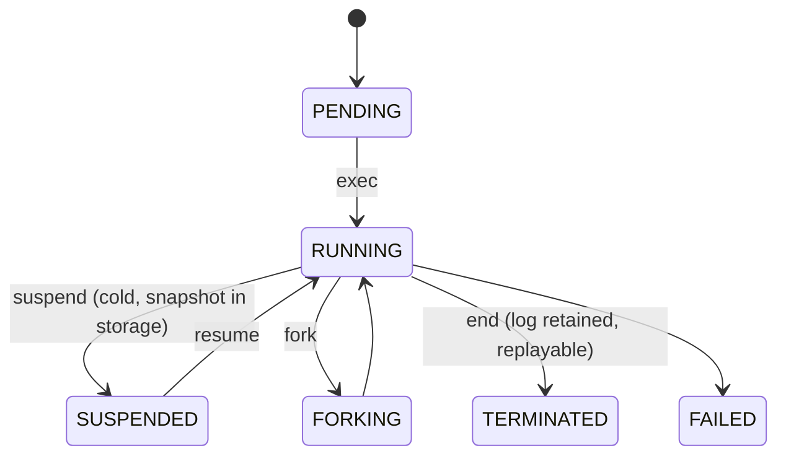
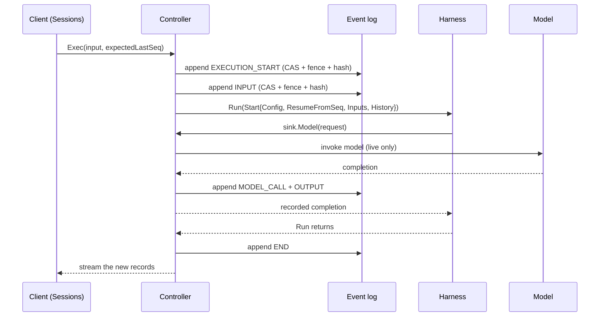

# Concepts

The mental model behind `agentsessions`: the nouns, why each exists, and how they fit together. Read
this first, then [`quickstart.md`](quickstart.md) to see them in action and [`architecture.md`](architecture.md)
for the implementation.

## The one-paragraph version

An agent session is a durable, long-running conversation between a user (or a producer like an issue
tracker) and an agent. `agentsessions` stores that session as an append-only, hash-chained event log
and drives it through a single-writer controller. Because the log is the source of truth, a session
can be killed and reconstructed byte-for-byte by replaying the log, moved between compute backends,
forked to explore alternatives, and audited by anyone. The core knows nothing about which framework
wrote the agent or which cloud runs it.

## The three seams

`agentsessions` is a narrow waist with three pluggable contracts. Producers plug in on top, compute
plugs in underneath, and the harness is brought by the user.

| Seam | Contract | Who implements it |
|---|---|---|
| **Sessions** | `api/session.proto` | The client. A producer adapter (GitHub, Foundry, a CLI) drives create / exec / suspend / resume / fork / replay. |
| **Harness** | `api/harness.proto`, `api.Harness` | The agent author. One `Run` drives one turn and streams typed events. See [`harness-authoring.md`](harness-authoring.md). |
| **Runtime** | `api/runtime.go`, `api.Runtime` | The compute backend. A pod, Kata, Cloud Hypervisor, or agent-substrate provides the sandbox. |

The rest of this document is about the nouns those seams pass around.

## Session

A session is the durable unit. It has a stable UID (for example `sess-6ff29e8d93d3a4c65f6f38bc`) and
its entire truth lives in one event log. A session is not tied to a process: the same session can run
on one incarnation now, be killed, and continue on a different one later. Its lifecycle has two
independent axes, execution and compute (`api/state.go`), which are reported separately because
collapsing them loses which one actually moved. The diagram below reads them together:

`SUSPENDED` is cold: the snapshot is written to storage and the worker is freed. `TERMINATED` still
keeps the log, so a finished session stays replayable.

There is no warm pause. The state model reserves a warm tier, but no `Runtime` backend implements a
node-local warm checkpoint, so nothing can currently move a session into it and there is no operation
that tries. A session goes from live to a cold snapshot and back.

### Metadata and listing

The log holds what happened. It does not hold what the session *is* — the project that owns it, its
display name, the configured harness and model — because none of that is an event. That lives in a
metadata row alongside the log, written by `CreateSession` before any event exists. Caller-supplied
`labels` and `annotations` are stored there as JSON and returned by `CreateSession`, `GetSession` and
`ListSessions`, including after the journal is reopened.

This is why a session that was just created, with no turns and no compute, still shows up in
`ListSessions`. A listing derived from the event table alone would drop exactly the sessions a user
just started and is waiting on.

`ListSessions` reads that row, so a listing is complete after a process restart and does not depend
on anything held in memory. It filters on an exact `project`, never a wildcard, so a caller cannot
enumerate a tenant it did not ask for. Results are newest first and paged with a cursor that carries
the last `(create time, uid)` seen, so a session created while a caller walks pages neither skips
nor duplicates a row.

The cursor and lifecycle status are derived rather than caller-writable:

- `last_seq` is derived from the indexed event head, including events appended by an older writer
  that does not update the approval projection.
- `compute_state` is a projection maintained in the same transaction that appends an event, since an
  event body is an opaque blob no query can filter on. It records **what the log implies about
  compute**, not a live probe of the backend. Execution activity implies `LIVE`; `SUSPEND` and
  `FORK` land it `COLD`, and `RESUME`
  returns it to `LIVE`. A session that has been created but never run stays `NONE`, which is what
  makes it visible in a listing before it has any compute. `LIVE` goes stale if the process behind
  it later died. A backend that can enumerate its own incarnations is the thing that would make this
  exact; reconciling against the runtime is not implemented. Approval requests/decisions do not
  themselves move compute: a request repair or pending query cannot prove that a snapshot committed.
- `pending_approval` is an output-only tuple projected inside the append transaction. Metadata,
  correlation and `last_seq` are read atomically; rendering does not decode the journal. Later
  appends do not change an earlier captured response, including one with a zero cursor.

### How exec_state is derived

Every Session reply — Create, Get, List, Fork, Resume, Suspend, Approve, Delete and Exec frames
— uses the same captured projection. No pre-deletion event reports `PENDING`. A valid owned
unanswered host request in the latest execution (ordered by first-seen non-lifecycle identity)
reports `AWAITING` and exposes `pending_approval` on ACTIVE sessions. Deleted sessions retain
`AWAITING` for audit but expose no actionable reference. Requests and decisions match execution
ID, call ID and the request's journal sequence. Errors and ordinary lifecycle markers do not
resolve it; a decision, END, or newer execution removes the pending reference.

Calls whose TOOL_CALL precedes a child's latest FORK marker are inherited and excluded from
reporting. A later call in an inherited execution belongs to the child and can report its own
request. Controller admission, decisions and recovery validate the same per-call ownership rule
independently of the reporting projection.

Malformed approval-bearing evidence anywhere in the captured history suppresses actionable
references, matching strict inspection. Malformed nongated histories do not. A projection
lagging the journal head also suppresses references. If an already-open older writer skips
projection updates, later appends and deletion do not restore reporting by skipping the missing
evidence. A v2→v3 backfill isolates an undecodable session, preserving its cursor/metadata but
permanently withholding references while healthy neighbors remain readable. SQL faults abort the
migration. Queries are not integrity checks: raw journal reads/Verify and strict commands still
detect undecodable evidence.

Other histories retain the compatibility `COMPLETED` fallback, including ordinary/legacy interrupted
turns and decided calls without receipts. That status does not prove completion or admission: an
unreceipted owned call still blocks new input. Execution and compute axes are independent; recovery
uses the journal rather than trusting an enum.

A fork inherits the parent's `project`, `harness` and `model`, because those define the workload and
a branch of a run is still that run. It does **not** inherit the parent's name. A name is a label the
caller chose for humans, and copying it makes a listing report N+1 rows that all claim to be the same
session. Synthesizing one instead (`"<parent> fork 2"`) would push a presentation convention into the
wire contract, and the counter is wrong as soon as the same parent is forked by two separate calls.
So a child is unnamed unless the caller names it with `ForkRequest.child_names`, which takes either no
entries or exactly `count` of them. Lineage is not lost by this: `parent_uid` and `fork_seq` are
stored on the child, so a caller that wants to show "branched from X" has the structured data to
build it from and does not need the server to flatten it into a string.

Map metadata follows a separate rule: each child gets exactly `ForkRequest.labels`, never a merge
with or copy of the parent's labels. Leaving request labels unset or empty gives children an empty
label map. The parent's `annotations` and `origin` are inherited unchanged. Both maps are persisted
and returned in the fork response and subsequent `GetSession` and `ListSessions` calls.

`ForkRequest.identity` is unsupported because per-child principals are not enforced. Any supplied
identity, even an empty message, is rejected with `INVALID_ARGUMENT` before placement,
provisioning, or journal mutation. Leave it unset to fork; children do not inherit the parent's
identity. This does not change `Session.identity`, which remains recorded provenance rather than
authorization (see [security posture](security.md)).

### Permanent soft deletion

`DeleteSession` atomically appends one session-scoped `DELETE` lifecycle record, advances the fence
and permanently tombstones the UID. `deletion_state` is independent of execution and compute:
`ACTIVE` has no deletion request time; `PENDING` has the committed request time.
Delete preserves the recorded compute state, not a claim that a running actor has stopped.

`PENDING` acknowledges durable intent only. Until ownership and cleanup are implemented in #88,
actors, snapshots and fork-child pins remain retained indefinitely: Delete does not call
`Runtime.Stop`, reclaim resources or report cleanup completion. Metadata and the immutable journal
preserve route, lineage and snapshot evidence for audit, not an authoritative cleanup-target
inventory; #88 owns that schema. Do not infer cleanup from gRPC OK.

List hides tombstones before pagination. Get and raw `Sessions.Replay` remain audit reads, including
`DELETE`; UID, metadata and journal are retained forever. There is no UID reuse, cascade or erasure.
Existing children and grandchildren retain independent copied prefixes and can continue and fork.
Exec, Fork (even at a historical sequence), Resume, Suspend and Approve (including exact historical
decision retries) refuse a deleted UID with
`FAILED_PRECONDITION`; neither a new Exec nor restoring a harness can reactivate it. Retrying Delete
returns the same PENDING snapshot, timestamps, fence, journal and compute projection. DELETE
advances `last_seq` while preserving captured approval evidence and the execution axis; an empty
deleted session remains `PENDING`, and a parked request remains `AWAITING` without an actionable
reference.

An empty UID is `INVALID_ARGUMENT`, an unknown UID is `NOT_FOUND` without creation, and local
overlap is `ABORTED` before mutation. Retry busy calls after the holder finishes; use Get or
retry after a lost response to learn whether intent committed. One Registry serializes Delete,
Exec, Fork, Resume, Suspend and Approve across its Placers. This is not cross-host compute
exclusion: an independent host can provision before its first durable fence. This build's
writers reject subsequent durable writes to tombstones; already-open older writers do not.
Follow the [v4 rollout order](../CHANGELOG.md#sqlite-v4-rollout) before the first upgraded open.
Direct durable-log wrappers must forward the optional `CheckWritable` preflight to refuse before
compute; this build's storage write barriers still enforce the permanent tombstone.

Opening an older SQLite journal migrates it transactionally through approval-reporting v3 to
schema v4, with old sessions ACTIVE and deletion times absent. Existing metadata, projections,
records and hashes are preserved. Older binaries refuse the newer schema at open time; stop all
older writers as described in the rollout note and back up before upgrading if rollback is required.
Old verifiers cannot verify new `LIFECYCLE_DELETE` enum-name hashes; use a descriptor with DELETE.

## Event and the typed log

The session log is a sequence of `Event`s. An event is not an opaque blob: it is typed, so provenance,
cost, audit, and tool approval are first-class rather than parsed out of text after the fact. The
`EventKind`s (`api/types.go`):

| Kind | Meaning |
|---|---|
| `EXECUTION_START` | Host-owned execution config, cursor, input count, resolved harness name and advertised version, recorded before inputs for every new execution. |
| `INPUT` | A user or producer input message. |
| `MODEL_CALL` | A call to a model was made (records the model, params, and an input hash for the replay check). |
| `OUTPUT` | Assistant output (a delta or a full message). |
| `TOOL_CALL` / `TOOL_RESULT` | A tool invocation and its outcome. Aligned with an MCP tool call. |
| `APPROVAL_REQUEST` / `APPROVAL_RESULT` | A host-owned request and explicit caller decision around a stateless tool call. |
| `USAGE` | Per-call token and cost accounting. |
| `LIFECYCLE` | A compute or session transition (`SUSPEND`, `RESUME`, `FORK`, `BASELINE`, `CANCEL`, `DELETE`). |
| `END` | The terminal state of one execution (`COMPLETED` / `FAILED` / `CANCELED`). |
| `ERROR` | An error, mirroring a gRPC status. |

The same `Event` type is shared by the session log and the harness stream, so what a harness emits is
exactly what gets journaled; the host additionally owns invocation and lifecycle records. Content is
carried as A2A-style `Message`s (a role plus a list of `Part`s: text, file, structured data, an opaque
reasoning block, a model's tool call, or a tool's result).

### Durable execution invocation

The controller commits an `EXECUTION_START` before inputs or harness execution for every new
execution, including default-config, zero-cursor turns. It preserves opaque config bytes verbatim,
including binary data and whitespace, and records the harness cursor and expected `INPUT` count at
the same boundary. A direct `Controller.Exec` with no inputs records an explicit zero count.
The caller's `expected_last_seq` guards this first committed record; if that append fails, neither
the harness nor the model runs.

The marker also records the executing **registry name**, which may differ from the harness's
`Descriptor.ID`, and its advertised `Descriptor.Version`. Standalone controller/Placer calls use
the descriptor ID as the name unless an explicit host harness option supplies an alias. The
reference harnesses advertise replay version `"1"`; this is an author-owned implementation token,
not the host binary's release/build version.

Versioning is opt-in. Exec accepts an unversioned harness and records an empty version. Controller
Replay checks all completed invocations against its single supplied harness before the first `Run`;
interrupted Resume checks its selected turn before `Run`. A nonempty recorded version must match
exactly, including rejection of an empty served version. No trimming or semantic-version ordering
is applied. An empty recorded version retains existing behavior without a version check. Mismatches
return `ErrHarnessMismatch` or `ErrHarnessVersionMismatch` without harness `Run`, model, or tool calls or new
execution records; placement can already have allocated/restored compute and advanced its fence.
Controller Replay is not a multi-harness dispatcher: callers supply a matching harness/name or it
fails closed. `Sessions.Replay` still streams stored records without running or checking a harness.

`Sessions.Resume` routes an interrupted turn to its recorded registry entry, including that entry's
backend, model and tool executor. An unserved recorded name or mismatched version is
`FAILED_PRECONDITION`, never fallback to another harness. Restore the recorded entry/version before
retrying. A new Exec can supersede an ordinary interrupted turn and records its own invocation
identity; an owned approval call blocks new inputs until its receipt commits.
An override is still per-turn: session metadata is unchanged and a later Exec with no override uses
the stored default. An override cannot involve a memory-tier harness: when either the session's
served stored harness or the override is `REQUIRES_MEMORY_SNAPSHOT` (and they are not aliases of one
entry), the turn is `FAILED_PRECONDITION` before any compute is provisioned, fence minted or journal
written (`placement.ErrStatefulOverride`). Suspend and Fork follow the session's harness, so they
would neither checkpoint nor clone the RAM a memory-tier override leaves behind; and parking only an
override of a memory-tier session would leave the stored harness's live memory uncheckpointed.
Resume and no-input Exec recovery apply the same refusal to older interrupted overrides before
compute changes or journal repair. An ordinary interrupted override can be superseded with a new
Exec on the stored harness. A stored runtime without memory-snapshot support is not contacted for
this check, so a down remote stored harness does not block a stateless override. Completed Resume,
ordinary Suspend and Fork retain their existing session-default routing. An owned unreceipted
approval's Suspend uses its recorded invocation route, including retry after a failed automatic
snapshot or append. An inherited approval instead suspends through the child's stored default to
checkpoint its own compute; Resume still refuses unresolved inherited tool intents.

Older start markers without a name fall back to the session's stored harness; those without a
version retain unversioned behavior. These rules apply independently if only one field is missing,
and do not relax input-count validation. Remote checks use `Describe`, not negotiation on the
`Connect` stream; an endpoint/replica changing between those calls remains the documented
[operator-controlled address limitation](security.md).

The marker and inputs are separate appends. If an input append fails, or the process dies before all
inputs commit, the marker's count prevents recovery from running a different invocation. Before any
harness runs, controller Replay validates every completed invocation's count, and Resume validates
the last interrupted invocation. Missing/negative counts, mismatched committed input counts, and
payloadless `INPUT` records return `ErrInvalidExecutionLog` without running the harness/model/tool or
appending execution records. Explicit zero permits genuinely inputless invocations; all inputs
committed before a crash permits resume even if the harness has not run yet. Completed Replay skips
an incomplete trailing invocation and remains read-only. A historical fork cut before all expected
inputs likewise cannot resume, but completed prefixes and complete invocation boundaries still work.

For ID-bearing executions, controller replay and interrupted-turn resume reconstruct each `Start`
from its own recorded values, including in inherited fork prefixes. `History` is the exact prior
journal prefix: it excludes the
current execution's start marker and inputs, but retains markers from prior executions. Replay is
read-only; recovery serves already-recorded effects rather than repeating them. The harness cursor
is opaque and distinct from the append CAS cursor.

**Legacy logs:** an execution without an `EXECUTION_START` reconstructs with empty config and a zero
cursor, regardless of a new controller's `WithStart` option. Older builds discarded these values;
non-empty config or non-zero cursors from those executions cannot be recovered retroactively. No
SQLite schema migration or rewriting of existing records is needed. Experimental start markers
without `input_count` fail closed when their invocation is selected for resume or is completed for
replay: absence cannot distinguish a genuine inputless turn from lost inputs. Markerless logs retain
their prior behavior and lack completeness information; only older writers omit the marker.

Released v0.1.2 journals also lack execution IDs. Compatibility recognizes only their ID-less
execution event kinds (`INPUT`, `MODEL_CALL`, `OUTPUT`, `TOOL_CALL`, `TOOL_RESULT`, `USAGE`,
`END`, `ERROR`), with session-scoped lifecycle records allowed. Output deltas were ephemeral,
not journal records. Controller Replay preserves v0.1.2's one whole-log harness invocation:
all recorded inputs and the entire legacy journal as `History`, even for an unfinished log;
usage is excluded from the served effect stream. Multi-turn legacy journals retain the old
replay limitation (for example, echo can fail its model-input hash check), because inferring
turn boundaries would change historical behavior. Controller Resume instead selects only the
last `INPUT`, supplies its prior history, and continues an interrupted turn with ID-less records.
Legacy harness invocations receive a `legacy-<sha256>` compatibility ID in `Start` and transport
frames only. The digest includes the host-bound session UID, the original input record's sequence
position, and its canonical event content (whole-log Replay uses the first input; Resume uses the
last). If Replay has no input, it uses the first legacy record. Retrying the same turn preserves the
ID while the turn remains pending; identical legacy bytes in different sessions have distinct
IDs. A recorded END or ERROR finishes a legacy turn, so Resume then becomes a no-op. This namespace cannot collide with the controller's hexadecimal modern IDs. The token is
never copied into journal event identity, including when echoed by a remote harness. Direct
controller callers must bind a nonempty `WithSessionUID`; a selected legacy invocation without it
returns `ErrMissingSessionUID` before running the harness or appending execution records.
It still refuses unresolved inherited tool intents; a recorded model intent without a completion
still fails recovery rather than repeating the model call.

A new Exec may follow a completed, errored or unfinished legacy tail, just as v0.1.2 allowed another
Exec after a failure. Its `EXECUTION_START` is an explicit legacy boundary even without a preceding
END. Mixed Replay reconstructs the complete legacy prefix with its whole-log semantics, skips the
abandoned failed/incomplete tail, and replays each completed modern execution normally; modern
`History` still includes every original legacy event because Exec saw that same history. Resume
selects the last modern turn rather than reviving the superseded tail. A completed legacy prefix
includes a v0.1.2 crash recovered by the upgraded controller before a new Exec. ID-bearing modern
events without a start marker still require a finished legacy boundary; remaining invalid-log
refusals return `FAILED_PRECONDITION` through Sessions Exec/Resume.
Once an `EXECUTION_START` or ID-bearing execution event appears, subsequent ID-less execution
events are invalid, not legacy. ID-less start markers and other non-legacy kinds likewise fail
closed. Existing records and hashes are never rewritten.

**Rollback compatibility:** binaries older than this release fail chain verification for sessions
containing `EXECUTION_START`, reporting a `content_hash` mismatch. Rollback is not supported for any
session that executed a turn on this release, including existing markerless sessions that execute
another turn after upgrading. Replay streams and harness `History` now carry one extra
`EXECUTION_START` event per turn (in `History`, only prior turns).

## The event log: single writer, append-only, tamper-evident

The log (`eventlog/` reference in memory, `sqlitelog/` on disk) is where durability, concurrency, and
provenance all live. It has three properties stacked on an append-only sequence:

- **CAS on append.** Every append names the sequence number it expects to extend (`expectedLastSeq`).
  Two writers racing the same session: one wins, the other is rejected. This is what makes "single
  writer" enforceable rather than aspirational.
- **A fencing token per incarnation.** See [Incarnation and fence](#incarnation-and-fence).
- **A hash chain.** Each record carries `prev_hash` and a `content_hash` over its event. Change any past
  event and its hash no longer matches, and every later `prev_hash` link is now inconsistent. Tampering
  is detectable by recomputation, with no external index.

## Canonical hash and language-neutral provenance

The `content_hash` is not `json.Marshal` of a Go struct. It is **RFC 8785 JCS (JSON Canonicalization
Scheme) over the proto3-JSON form** of the event (`canon/`). Because the canonical form is defined on
the wire proto and not on any language's serializer, the chain is reproducible outside Go. A roughly
30-line Python verifier (`hack/verify_chain.py`) recomputes the exact Go hash for a golden vector and
audits a full real journal. Provenance you can only check with the original implementation is not
provenance, so this property is load-bearing.

## Incarnation and fence

An **incarnation** is one live compute instance of a session: a sandbox on some worker, with an address
where its harness listens. A session can outlive many incarnations (kill one, start another).

A **fence** is a monotonic token bound to an incarnation. The log is the single fence authority: a fresh
incarnation mints a higher fence, and the log rejects any append carrying a fence lower than the current
one. So if a supposedly-dead incarnation wakes up and tries to write (a zombie), its stale fence is
refused. Fencing plus CAS is how a session with automatic failover still has exactly one writer at any
instant.

## Resumability: replay or memory snapshot

How a harness survives suspend, resume, and fork is declared, not guessed. It is a property of the
harness (`api.Capabilities.Resumability`):

- **`STATELESS_REPLAY`** (the default). The harness keeps no durable in-process state beyond the log.
  To resume or fork, the host replays history into it (`Start.History`). This runs on any runtime,
  including a plain pod with no snapshot support. `echoagent` is the reference example.
- **`REQUIRES_MEMORY_SNAPSHOT`.** The harness holds in-process state that the log cannot reconstruct: a
  live REPL, a browser, a long-running computation. Resuming means restoring RAM, so the host only
  schedules it on a runtime that can snapshot memory. Forking means the same thing: the parent is
  checkpointed and each child is cloned from that snapshot, so a fork costs a suspend on the parent and
  is only available at HEAD. `counteragent` is the reference example.

The distinction is honest by design. A stateless-replay harness costs nothing special and goes anywhere.
A memory-snapshot harness gets a capability a plain pod structurally cannot provide, and pays for it by
being placeable only on memory-capable compute.

## Capability matching and `CanPlace`

A harness declares what it needs (`api.Capabilities`). A runtime declares what it can do
(`api.RuntimeCapabilities`, for example `MemorySnapshot`, `CoWFork`, `Attest`, `GPUState`). Before any
compute is provisioned, `CanPlace(harness, runtime)` (`controller/`) refuses a placement the runtime
cannot honor, for example a `REQUIRES_MEMORY_SNAPSHOT` harness on a filesystem-only backend. The result
is honest degradation up front (a `FailedPrecondition`), instead of resuming a session wrong and
discovering it later.

## Determinism invariants

Replay is only useful if it is exact. The controller (`controller/`) mediates every nondeterministic
effect through the harness event sink so the effect is recorded before it is observed, and the
replay-conformance suite (`conformance/`) enforces a numbered contract. The load-bearing rules:

- **I1: replay never invokes the model.** On replay the recorded model result is served from the
  journal. The model is called zero times.
- **I2: reasoning continuity.** Opaque provider reasoning parts are recorded verbatim and replayed, so
  reasoning survives resume and fork on the stateless path.
- **I3: at-most-once effect re-drive.** A crash between an effect's intent and its result is re-driven at
  most once. Host-executed tools carry an idempotency key so the re-drive dedups.
- **I4: memory-restore is not replay.** After a memory restore the harness already holds its state in
  RAM. The host still sends the full prior log as `Start.History`, and it must not be replayed into
  that state: a `REQUIRES_MEMORY_SNAPSHOT` harness never reconstructs state from `History` (see
  [`harness-authoring.md`](harness-authoring.md)).
- **I5: byte-identical replay.** Replay reproduces the recorded events byte-for-byte (checked against the
  canonical hash), not merely output that looks equivalent.

## How one turn flows

Putting it together, a single `exec` turn on a stateless-replay harness:

On **replay** the same sequence runs with one difference: at `sink.Model` the controller serves the
recorded completion from the log and never touches the model (I1). That is why a killed session comes
back byte-identically without spending a single model call.

## Glossary

| Term | One line |
|---|---|
| Session | A durable, event-sourced agent run identified by a UID. |
| Event | The typed unit of the log and the harness stream. |
| Event log | Single-writer, append-only, CAS + fence + hash chain. |
| Incarnation | One live compute instance (sandbox) of a session. |
| Fence | Monotonic token that makes single-writer enforceable across failover. |
| Canonical hash | RFC 8785 JCS over proto3-JSON, the language-neutral `content_hash`. |
| Resumability | `STATELESS_REPLAY` or `REQUIRES_MEMORY_SNAPSHOT`. |
| `CanPlace` | The gate matching a harness's needs to a runtime's capabilities. |
| Harness | The Bring-Your-Own-Harness agent behind the `api.Harness` SPI. |
| Runtime | The pluggable compute backend behind the `api.Runtime` SPI. |
| Producer | An adapter that maps an external world (issues, chat) onto sessions. |
