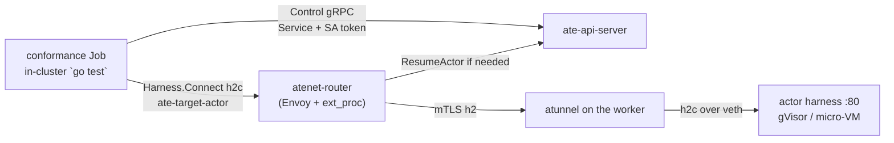

# Running on agent-substrate

`agentsessions` treats compute as a pluggable `Runtime` backend. [agent-substrate](https://github.com/agent-substrate/substrate)
(Google's OSS "actors on pre-warmed workers" runtime, with RAM+disk memory snapshots) is one such
backend. This document describes how the neutral core runs on **real** agent-substrate — proven
end-to-end in CI across both capability tiers — and how to reproduce it.

## The claim

On a fresh CI runner, in one kind cluster, `agentsessions` runs on a real `ate-system` (not a mock)
across both capability tiers, with the tamper-evident chain verifying across the snapshot boundary, the
gRPC harness transport unchanged, and the core importing zero substrate code:

- **`STATELESS_REPLAY` on a micro-VM:** place the echo harness, drive a turn, and replay the journal
  **byte-identically** with **zero** model invocations; the hash chain verifies.
- **`REQUIRES_MEMORY_SNAPSHOT` on a micro-VM (kata + cloud-hypervisor):** place the in-RAM
  counter, drive it to N, **suspend (memory snapshot) → restore**, and the count **continues** to N+1 —
  in-RAM state no journal replay could reconstruct, and a plain pod structurally cannot preserve.
- **Fork of a stateful session:** fan out k children from one parent checkpoint and every child
  **continues at N+1 independently**, with the parent still resumable at the same base.

All of it runs in the `substrate-conformance` job (`.github/workflows/substrate-e2e.yml`). Both tiers
run on the micro-VM sandbox class, so the suite exercises the same isolation class in both and covers
the micro-VM path end to end.

## Neutrality by construction

The core must not depend on substrate. The seam is a `ControlClient` interface **defined in the core**
(`runtime/substrate`), a small subset of substrate's ate-api Control gRPC:

```
CreateActor · ResumeActor · SuspendActor · DeleteActor · GetActor
```

`SnapshotCloner` is an optional second interface, also defined in the core, for the clone-from-snapshot
half of fork (`CreateTag`, `CreateActor{source_tag}`, `DeleteTag`). Keeping it separate means a control
client without substrate's Tag APIs still satisfies the base interface.

- `runtime/substrate` (in the core module) implements `api.Runtime` over that interface — no substrate
  import.
- `integrations/substrate` is a **separate Go module** with its own `go.mod` that adapts the real
  generated ate-api client to `ControlClient`. The core never imports it.
- A CI gate asserts `go list -deps ./...` on the core contains **zero** `agent-substrate` packages.

### Substrate placement binding

A session's journal records its harness name, not where that harness's actors live: the atespace,
the ActorTemplate and the declared tier come from the host's configuration, and the session store
keeps none of them. A `REQUIRES_MEMORY_SNAPSHOT` session's state lives in one actor's RAM, so a lost
or replaced actor loses it.

What is enforced today: `runtime/substrate` refuses to cold-create an actor for a
`REQUIRES_MEMORY_SNAPSHOT` session whose journal already has a started turn (an `EXECUTION_START`)
on that harness, whether that turn completed, failed or was interrupted, since any of them may have
changed the actor's RAM. The Placer hands `Create` a counter in `api.SessionSpec.StartedTurns`, and
`Create` calls it only after `GetActor` reports the actor missing, so a turn journaled before that
point is counted, including one another host ran. The Placer attributes a turn by the harness name
its `EXECUTION_START` recorded: a turn an `ExecRequest.harness` override sent to another harness is
not counted, a name that aliases the same Placer in the registry is, and so is a turn it cannot
attribute (no recorded name, a name this host does not serve, a legacy turn with no
`EXECUTION_START`, or any turn when the Placer is not in a registry, since it cannot tell which
backend another name ran on), so an unknown history refuses rather than cold-creates. A journal
that cannot be read refuses too. `Create` returns `substrate.ErrMemoryStateLost` (wrapping
`api.ErrMemoryStateLost`, `FAILED_PRECONDITION` at the Sessions API), names the session, and creates
nothing. A stateless session, or a memory-tier session with no started turn, is created as before.

The count cannot see a turn journaled after it. Host A finds no actor and counts no turn; host B
then creates the actor, runs the session's first turn, and loses the actor; A's `CreateActor` then
creates a replacement under the session's name, which every later `GetActor` finds. The actor's
identity covers that case. A memory-tier incarnation carries the actor's UID
(`ResourceMetadata.uid`, which substrate assigns at create and keeps across suspend and resume) as
`api.Incarnation.ComputeInstance`, and each turn records it in `EXECUTION_START.compute_instance`.
A fork child's `FORK` marker records the UID of its clone (see [A fork child's clone
UID](#a-fork-childs-clone-uid)). Before `Exec` journals a turn, the controller compares the UID of
the actor it was placed on with the latest UID recorded for that harness since the session's `FORK`
marker, or the clone's UID that marker recorded (attributed as above), reading
the history its compare-and-swap append extends, so a turn another host journaled first is either
compared or makes the append fail. `Resume` makes the same comparison before it re-drives a turn or
records the resume. A different UID is `api.ErrMemoryStateLost` (`FAILED_PRECONDITION`), names the
session, and journals nothing; so is every later turn on either host. `Suspend` and a stateful
`Fork` make the same comparison against the session's actor: the Placer reads the session's journal
(at the fork point, for a fork) and passes the latest recorded UID to `Runtime.Snapshot`, and
`runtime/substrate` refuses another actor, or a missing one, with `api.ErrMemoryStateLost`
(`FAILED_PRECONDITION`) before it suspends it, and again on the UID the suspend reports, since
substrate's `SuspendActor` takes no UID precondition. Neither then appends a `SUSPEND`, so the
journal never records a replacement's snapshot as the session's checkpoint, and the fork clones
nothing and records no child, where it would otherwise have cloned the replacement into children
whose own turns never compare against the parent's UID. `runtime/substrate` refuses to place a
memory-tier session on an actor that reports no UID, and refuses to snapshot one with a plain error
(`INTERNAL`), a fork child before its first turn included, since a `ControlClient` that reports no
UID breaks its contract. When `CreateActor` finds the name taken (`substrate.ErrActorExists`),
`Create` attaches to that actor, so two hosts racing a session's first turn share one actor. The
loser's turn fails at worst, never the session, and a retry attaches: `ABORTED` when its append
loses, and `ABORTED` (`api.ErrComputeBusy`) when it finds the winner's actor `RESUMING`,
`SUSPENDING` or `PAUSING`, or substrate refuses its resume because another operation holds the actor
(substrate's `ABORTED`, reported as `substrate.ErrActorBusy`). An actor that is `CRASHED`,
`DELETING`, `REVERTING` or in a state the adapter does not know is `INTERNAL`. When `Create` resumes
a `SUSPENDED` actor and the resume reports it missing (`substrate.ErrActorNotFound`), `Create` reads
it again: gone, it is a missing actor (a memory-tier session with started turns is
`ErrMemoryStateLost`, anything else gets a new actor); replaced under the name, it is `ABORTED`;
still there, the resume error stands, since substrate also answers `NOT_FOUND` for an actor whose
template lacks a volume. `Restore` (`Sessions.Resume`) returns `ErrMemoryStateLost` for every
memory-tier session whose actor is gone, whatever its journal records (a session interrupted on its
first turn included), since the snapshot it would resume went with the actor: after the resume
fails, `GetActor` finds no actor, or, when the resume reported it missing, a replacement: one that
does not hold the snapshot being restored, or, when the session has no `SUSPEND` recorded (its host
died during a turn) and so no snapshot to compare, one whose UID is not the one the journal last
recorded for that harness. The Placer passes `Restore` a reader for that UID
(`api.InstanceRestorer`), called after `GetActor` answers. The recorded actor itself, or an actor
with nothing to compare against (no snapshot and no recorded UID), keeps the resume error.

Limits of these checks:

- The check only sees the tier the daemon is configured with, so it does not cover a mis-declared
  tier.
- The router reaches an actor by name, and the backend reads the UID when it looks. A turn that is
  already placed when its actor is replaced runs on the replacement and records the old UID; the
  next turn is refused, so one turn's output can come from a harness without the session's state.
- Turns journaled before `compute_instance` existed recorded no UID and are not compared.
- `EXECUTION_START.compute_instance` and `Lifecycle.compute_instance` are in the record's canonical
  bytes. A binary built before them drops the fields on read and fails chain verification
  (`content_hash` mismatch) on a session with a memory-tier turn or a memory-tier fork child, so
  every host sharing a journal must be upgraded before any of them runs one, and rollback is not
  supported for such sessions.
- A fork child whose `FORK` marker records no UID (a marker written before
  `Lifecycle.compute_instance` existed) is not compared before its first turn: an actor someone
  else created under the child's name in that window is attached to. The started-turn count still
  refuses to cold-create a missing child actor, since it includes the inherited prefix.
- The refused replacement actor is not deleted: it keeps its name and any worker it holds until an
  operator deletes it.

Open questions, not implemented:

- Can the atenet-router target an actor by UID, or reject a request whose expected UID differs? If it
  could, a turn already placed would never reach a replacement actor.
- Should `runtime/substrate` verify the live harness's `Describe` resumability against the configured
  tier, given that `Placer.recheck` runs only for a `LiveDescriber` backend and does not compare
  tiers?

### A fork child's clone UID

A memory-tier fork child runs on a clone of the parent's actor, with its own UID, and its copied
prefix records only the parent's UIDs, which do not count for it. Without a record of the clone, the
child had nothing to compare with until its first turn recorded one, so an actor created under the
child's name in that window (the clone deleted out of band and another created in its place) was
attached to as if it held the cloned RAM. The child now records the clone's UID at fork:

- **Where.** In `Lifecycle.compute_instance` on the child's own `FORK` marker, set from the
  `ComputeInstance` of the incarnation `Runtime.Fork` returned. For substrate that is the UID
  `CreateActor{source_tag}` assigned the clone, and `Fork` returns it only when `ResumeActor`
  reports the same UID: the clone is `SUSPENDED` between the two calls, so it can be deleted and
  another actor created under the child's name, and `ResumeActor` resolves the name. Another UID
  is `substrate.ErrActorBusy` (`ABORTED`; the parent still holds its snapshot and a retry mints a
  new child), the fork records no child, and the replacement is left in place. The Placer clones
  each child before it writes the child's journal, so the UID is known when the marker is appended.
  The marker is already one per child, so no new record is needed; a separate per-child record was
  rejected because it would be a second append that can fail after the marker (leaving the gap) and
  a new event kind older readers do not know. A backend that sets no instance (a stateless fork)
  records none.
- **Comparison.** `controller.LatestComputeInstance` returns the marker's UID until the child's own
  first turn records one; the marker is attributed like a turn with no recorded harness name. So the
  child's first `Exec` and a `Resume` compare the actor they were placed on with it, `Suspend` and a
  stateful `Fork` of the child pass it to `Runtime.Snapshot`, and a `Resume` with no `SUSPEND`
  recorded reads it through `api.InstanceRestorer`. Another UID is `api.ErrMemoryStateLost`
  (`FAILED_PRECONDITION`): nothing is journaled, snapshotted or cloned and the harness does not run,
  as for every other identity check above. The error names the child and the `FORK` marker's clone.
- **Hash chain.** `compute_instance` is part of the marker's canonical bytes when it is set. proto3
  JSON omits an empty field, so a marker that records no UID canonicalizes and hashes exactly as
  before. `canon` and `hack/verify_chain.py --golden` pin both forms as interop vectors, and
  `hack/verify_chain.py --journal` reads the field from the schema it builds. The child's copied
  prefix is unchanged and still shares the parent's prefix hashes.
- **Journals written before the field.** Their `FORK` markers record no UID, so a child forked by an
  older build keeps today's behavior: its first turn is not compared, attaches to whatever actor is
  under its name, and records that actor's UID for the turns after it.
- **Older binaries.** A v0.1.x binary never reads the field: the journal is SQLite schema version 3
  and v0.1.0 through v0.1.2 refuse it at open (`unsupported database schema`). A build from before
  this change that opens version 3 decodes the marker without the field, so it does not compare the
  child, and its `Verify` fails with a `content_hash` mismatch at the marker, or at an earlier
  record carrying `EXECUTION_START.compute_instance`. A fork it takes of such a child re-appends the
  copied prefix without the fields, so the new child's chain verifies on its own but no longer
  shares the prefix hashes. This is the same as for `EXECUTION_START.compute_instance`, and the same
  rollout applies.

## SPI → substrate mapping

| `api.Runtime` | substrate Control |
|---|---|
| `Create` | `CreateActor` + `ResumeActor` (starts from the template's golden snapshot, or cold-boots); refused for a memory-tier session with started turns and no actor |
| `Snapshot(EXTERNAL)` | `SuspendActor` (RAM+disk snapshot to storage, worker freed, actor SUSPENDED) |
| `Restore` | `ResumeActor` (restores the actor's own snapshot on a possibly-different worker) |
| `Fork` (stateless) | `CreateActor` + `ResumeActor` — a replay-fork; the journal reconstructs the child |
| `Fork` (memory) | `CreateTag{source_actor}` + `CreateActor{source_tag}` + `ResumeActor` — clones the parent's RAM |
| `Stop` | `SuspendActor` + `DeleteActor` |
| `Status` | `GetActor` |

There is no per-resume boot flag (substrate removed `ResumeActorRequest.boot`). Substrate picks the
source itself: the actor's own snapshot, else the template's golden snapshot, else a cold boot of the
template spec. That is enough for `STATELESS_REPLAY`: a new actor has no snapshot of its own, and the
golden snapshot is the harness captured right after it became ready, before any session touched it,
so it carries no session state. A template that must cold-boot on every resume would set
`snapshotConfig.preferredFidelity: SNAPSHOT_FIDELITY_VOLUMES` instead; nothing here needs that.

`Capabilities.MemorySnapshot = true` is the tier that lets substrate host a `REQUIRES_MEMORY_SNAPSHOT`
harness a filesystem-only backend (`runtime/local`, a plain pod) refuses via `CanPlace`.

## Fork: cloning an actor from a durable snapshot

Every successful `SuspendActor` leaves the actor holding a new external snapshot: a new generation in
`Actor.status.snapshots` whose durable copy is `COMPLETED`. The adapter reports the highest such
generation's URI as the held snapshot, the same one `ResumeActor` restores and `CreateTag` copies.
`CreateTag{source_actor}` copies the snapshot a SUSPENDED actor holds into tag-owned storage, and
`CreateActor{source_tag}` seeds a new actor from that copy. That is the compute half of a session
fork.

There is no `Fork` RPC to wait for. The Control service exposes no method that forks or clones an
actor directly; tags are the primitive it provides. That is the right half of the split: the compute layer copies a sandbox,
while branching the log, holding the fence, and recording lineage stay session-layer concerns this
repo owns. A session fork is therefore something to build here, not something to request upstream.

How the session layer uses it:

- **A `STATELESS_REPLAY` fork stays a replay-fork.** The parent's RAM holds nothing the journal
  lacks, so the child cold-boots and replays. The parent keeps its worker and its log is untouched.
- **A `REQUIRES_MEMORY_SNAPSHOT` fork must clone.** The parent's live state exists only in RAM and
  the harness never rebuilds it from `History` (I4), so cold-booting the child would silently produce
  a divergent branch. The Placer checkpoints the parent, records the ref in a SUSPEND event on the
  chain, and clones each child from it.
- **A fan-out shares one checkpoint.** `Fork(count: N)` snapshots the parent once and clones N
  children from that single snapshot, so the whole fleet branches from identical state. A turn on
  the parent would wake it and replace that snapshot, so the Placer refuses one with
  `ErrCheckpointing` (ABORTED) until the last child is cloned. A second stateful fork or a
  `Suspend` of the parent in that time is refused the same way, before it fences or snapshots
  anything, so it can neither fail the first fork's SUSPEND record nor replace its snapshot; a fork
  that arrives while a `Suspend` runs is refused too. A fan-out that fails partway
  releases the parent before it tears the cloned children down.

Constraints inherited from substrate, enforced or surfaced rather than papered over:

- `CreateActor` seeds an actor **only from a tag**, and a tag names the suspended parent **actor**,
  capturing whichever snapshot it holds when the tag is created. The router resumes an actor on any
  request addressed to it, so the parent can be woken and suspended again between the fork's
  checkpoint and its tag. The backend checks on both sides of the tag that the parent is still
  SUSPENDED holding the snapshot the fork took (a suspend always writes a new one), and otherwise
  deletes the tag and fails with `ErrSnapshotSuperseded`. That error wraps
  `api.ErrSnapshotSuperseded`, which `Fork` reports as ABORTED; the caller retries at the parent's
  new head. When the tag itself fails, the backend reads the parent again: a parent that is gone is
  `api.ErrMemoryStateLost` (FAILED_PRECONDITION), and one holding another snapshot is
  `ErrSnapshotSuperseded`. A tag substrate refuses because another operation holds the parent's
  lease (`ABORTED`) is `substrate.ErrActorBusy`, also ABORTED. The Placer's hold on
  the parent starts when the fork installs its checkpoint mark and covers the turns this
  `placement.Registry` drives. It does not stop a request from outside this Registry, or a turn whose
  `Runtime.Create` or `Runtime.Restore` was already in flight when the mark was installed; this
  check is what catches those.
- The backend takes one tag per child (`fork-<child-uid>`, atespace-scoped). Each tag owns a full
  copy of the snapshot, and a child borrows its tag's copy until its own first suspend, so the tag
  lives as long as the child and `Stop` deletes it after deleting the child.
- A clone requires the snapshot's **exact source `ActorTemplate`**, and templates with external
  volumes are rejected.
- A memory clone reflects the parent's RAM **now**, so it can only realize a fork at the log head.
  Forking a stateful session at a historical seq is refused with `ErrUnplaceable` →
  `FailedPrecondition` instead of pairing an old prefix with present-day RAM.
- A memory clone must come from the actor the parent's turns ran on. When the actor under the
  parent's name has another UID than the parent's journal last recorded, the fork is refused with
  `api.ErrMemoryStateLost` → `FailedPrecondition` before the backend suspends it, or, if it was
  replaced between that look and the suspend, after: the replacement is then left suspended, with
  no SUSPEND event on the parent's chain and no child.
- A child must be resumed on the clone the fork created. `CreateActorFromTag` reports the clone's
  UID from `CreateActor`'s response, and `Fork` refuses a `ResumeActor` that reports another one
  with `substrate.ErrActorBusy` (`ABORTED`), since the clone was deleted, and maybe replaced under
  its name, while it was `SUSPENDED`. When the resume fails, the backend reads the child's name
  before it cleans up: it tears down only the actor with the clone's UID (the resume's error
  stands), releases just the tag when the name is gone or holds another actor (`ABORTED` too), and
  touches nothing when the read fails. `Stop` suspends and deletes by name, so an actor created between that read and the
  delete is not protected.
- A control client without the Tag APIs does not satisfy the optional `SnapshotCloner` interface; a
  stateful fork there fails loudly rather than degrading to a lossy replay-fork.
- The child fan-out is all-or-nothing. If a child fails to provision, the ones already created are
  torn down and their tags released before the error returns, since their UIDs are never handed to
  the caller and an orphan would be unreachable. Teardown runs on a context detached from the
  caller's, because the likeliest cause of a mid-fan-out failure is the caller's deadline expiring.
- The parent checkpoint is not part of that rollback, because it cannot be. Once a stateful fork
  reaches the point of snapshotting, the parent is cold with a SUSPEND event on its chain whether or
  not the children go on to provision. That is a recoverable state (`Resume` brings the parent back),
  but a retry must fork at the new head rather than the original seq.
- The fork checkpoint is committed under a fence and a CAS on the seq the caller validated, so a turn
  racing the fork can never widen the children's prefix past the RAM they were cloned from. A fork
  that is *refused* takes the fence path not at all: a request that changes nothing must not
  supersede a turn in flight on the parent. A stateful fork that proceeds does supersede it,
  closing its harness stream before checkpointing; Suspend instead refuses overlap with a turn.
  Fork holds shared deletion admission through checkpoint, fan-out and rollback, so Delete is
  refused until it returns. Failed fan-out releases the checkpoint before rollback, allowing new
  parent turns while the failed children are stopped. Independent Registries or hosts are outside
  this local admission. A fork that mints its fence and then aborts on the re-check still supersedes
  the writer that beat it even though it gives up. Closing that needs a read-only fence
  accessor on `eventlog.Store` (`NewFence` is currently the only way to obtain one, and it mutates),
  which is a wider API change than this path warrants.
- Ending the parent's harness streams sits between two fences. The first stops an in-flight turn
  from writing an `ERROR` for the interruption; a turn that mints a newer fence in that window sees
  that the checkpoint claimed its connection and writes nothing. Ending a stream only cancels the
  turn, so the checkpoint then waits, bounded by the caller's context, until every ended turn has
  made its fence call or returned. Only then is the second fence minted, the one the SUSPEND record
  is written under, so no turn this Registry drives can fail the record after the parent is already
  cold.
  The connections and the checkpoint mark are per session and shared by every Placer of a
  `placement.Registry`, including one `Registry.Add` registers later, so a turn routed to a
  different harness by `ExecRequest.harness` is covered.
  If the context ends first, the fork aborts before it snapshots. A turn driven by another process
  is outside this: only the log fences it.

Two properties make the failure paths above safe, both read off substrate's suspend/delete workflows
(`cmd/ateapi/internal/controlapi/`) rather than assumed:

- **`SuspendActor` is idempotent on an already-SUSPENDED actor.** Every step after the load
  fast-forwards on its `IsComplete` check, so the call is a no-op that returns the actor still
  carrying its original external snapshot. Retrying a fork whose fan-out failed after the checkpoint
  therefore neither errors nor mints a second snapshot — it re-reads the same one.
- **A clone that never resumed is still deletable.** `CreateActor` starts an actor at
  `ACTOR_STATE_SUSPENDED`, and `DeleteActor` accepts `SUSPENDED`, `CRASHED`, or `DELETING`. So the
  suspend-then-delete teardown the backend runs works on a child that failed at `ResumeActor` and
  still holds the clone's UID, and rollback does not strand an actor or leak its tag.

### It is not copy-on-write

`RuntimeCapabilities.CoWFork` stays **false**. Each fork tag copies the parent's snapshot in object
storage, and substrate restores each actor into a private per-actor directory, so an N-way fan-out
costs N snapshot copies and N full restores, and the memory image dominates the transfer. Fork is cheap in the sense that it skips re-deriving state, not in the sense that
children share pages.

The first green run, at the earlier substrate pin where a tag did not copy the snapshot, measured a
3-way fan-out at **5.06s total, ~1.69s per child**, on a kind cluster with the counter harness's
small memory image. The suite logs the fan-out time on every run.

Read that as an existence proof, not a bound: it is one snapshot size on one sandbox class. How
the cost scales with snapshot size, and whether a paused (node-local) parent changes it, has not
been measured.

## Placing an actor is idempotent

`Placer.Exec` calls `Runtime.Create` on **every** turn, so on substrate `Create` resolves the actor
rather than assuming it is new — `CreateActor` rejects a repeat with `AlreadyExists`, and a cold boot
would discard whatever the actor already holds:

| Actor state | What `Create` does | Why |
|---|---|---|
| absent | `CreateActor` + `ResumeActor` | first placement; the actor starts from the template's golden snapshot, which holds no session state |
| `RUNNING` | attach, return its incarnation | the second and later turns of a session, and the first turn of a **forked child** |
| `SUSPENDED` | `ResumeActor` | restores the actor's own snapshot: the RAM is what must come back |

The forked-child row is the one that matters for this feature. A child's actor is created from the
parent's snapshot and resumed **before** its UID is handed out, so it is already `RUNNING` when the
first turn lands; cold-booting it there would throw away the cloned RAM the fork exists to carry, and
the harness would never rebuild it (I4). A control-client double that accepts every `CreateActor`
cannot see any of this, which is why it is asserted against a live cluster.

### Suspend and Resume failure boundaries

An `Exec` after `Placer.Suspend` does not require an explicit `Placer.Resume`: `Create` resumes the
SUSPENDED actor, which restores its own snapshot, then the controller records the new execution. This path preserves
the actor's captured state but does not append a RESUME lifecycle marker.

`Placer.Resume` restores compute before dialing the harness, minting a fence, recovering any interrupted
turn, and appending RESUME. If a step after `Restore` fails, the actor may already be RUNNING while the
journal's last lifecycle marker is still SUSPEND. There is no automatic re-snapshot on this failure.
A later successful `Suspend` checkpoints the running actor and records a new SUSPEND; a later successful
`Exec` attaches to it and records a new execution without a RESUME marker. Either reconciles the
recorded compute state with the actor; neither rolls back effects from a failed interrupted turn.

## The transport: harnesswire through atenet-router

The harness is a `harnesswire` gRPC server on port 80 in the actor. The host reaches it the only way
current substrate supports: through `atenet-router`, the cluster's actor ingress.

- Every substrate incarnation carries the router address (`atenet-router.ate-system.svc:80` by default,
  `substrate.WithRouter` to override) and `CallMetadata` of `ate-target-actor: <atespace>/<actor>`.
  The Placer's dialer attaches that metadata to every call. The router ignores the host and
  authority; the header alone selects the actor (substrate `internal/atenet/headers.go`).
- The router accepts h2c and carries gRPC unary, server-streaming and bidi calls, trailers included,
  to the actor (substrate #1183; upstream e2e `TestIngressGRPC`). It resumes a suspended actor on
  request, then forwards over mTLS to the worker's atunnel, which checks the actor is assigned to it
  and proxies to port 80 over the actor's private veth.
- Substrate removed the worker pod-IP:80 ingress on purpose (substrate #559), so there is no direct
  path to fall back on, and the conformance Job needs no NetworkPolicy exception.



Limits that come with the router, measured or read rather than assumed:

- **Route timeout.** The router sets `--route-timeout` (5m by default, one global value) and a
  route-level stream idle timeout 30s past it (`routeIdleTimeout` in
  `cmd/atenet/internal/router/xds.go` at `fc0e3586`). `TestHarnessStreamIdlePastRouteTimeout` holds
  a Connect stream idle, as a turn parked on a slow model call does. On kind, with the echo harness
  on gVisor, the router tore the stream down after **5m30s**, both at `362637f9` and at `fc0e3586`
  (held idle for 6m30s): a pending `Recv` got `Internal` "stream terminated by RST_STREAM with error
  code: INTERNAL_ERROR", not a 504. Through the Placer, which does not read while the host's model
  call runs, the turn failed only when the host sent its late reply, with a bare `EOF` (measured at
  `362637f9`). So a turn that runs longer than the route timeout fails once its stream has been idle
  past the idle timeout (5m30s by default). Until substrate offers a per-route or streaming timeout
  (tracked in substrate issue 1291), raise the router's `--route-timeout` above the longest turn;
  the idle timeout follows it.
- **Checkpoint drain.** Before it snapshots, the worker waits for the actor's in-flight requests to
  finish, and an idle open Connect stream is one of them. On kind with the echo harness on gVisor, at
  `362637f9`, `SuspendActor` under such a stream took **5m30s**: it waited for the router to reset
  the stream. `Placer.Suspend`
  therefore never checkpoints under a turn it knows of: while an `Exec` or `Resume` of the session
  runs, it is refused with `ErrSessionBusy` (ABORTED), and once the turn has returned its stream is
  closed. A stateful `Fork`, which supersedes the running turn instead, closes the parent's harness
  streams before it checkpoints. `TestSuspendUnderAnIdleHarnessStream` checks the Suspend half on a
  live cluster. Both cover turns any Placer of this process's `placement.Registry` drives; a turn
  driven outside this Registry is fenced by the log, but its stream stays open until it next touches
  the log and can still stall a checkpoint.
- **No caller authentication.** The router does not check who is calling before it resumes an actor
  and proxies to it, so any pod that can reach it can drive any harness. See
  [security.md](security.md).

## The suite (`integrations/substrate/e2e`)

The conformance suite is an ordinary Go test package, compiled with `go test -c` and run as an
in-cluster Job. A capability is a `Test` function, not a bespoke driver binary: adding one means
writing a test, not writing another `main`, another Job manifest, and another copy of the polling
shell. Tests skip unless `AGENTSESSIONS_E2E=1`, so the cheap per-PR job still compiles every line of
the suite — a driver that no longer builds fails in seconds rather than 15 minutes in.

### `TestStatelessReplay` — stateless-replay

Places the echo harness (`STATELESS_REPLAY`, on a micro-VM unless `ECHO_SANDBOX_CLASS=gvisor`)
through the `Placer`, drives one turn through the router, then re-dials and replays. Asserts: replay
is **byte-identical**, model invocations are **0** (I1), and the hash chain verifies. Same determinism
triple as the unit conformance suite, now through the substrate router.

### `TestSessionSuspendResume` — session-level stateless suspension

Places the echo harness through the `Placer`, executes a turn, calls `Placer.Suspend` and explicit
`Placer.Resume`, then executes another turn. The recorded snapshot retains the actor handle required
by Restore, and both lifecycle markers and subsequent output remain on a valid hash chain. This
regression is selected alongside stateless replay in the stateless-tier CI pass.

Cold suspension is not teardown: `Snapshot(EXTERNAL)` releases the worker and keeps the actor
SUSPENDED; `Stop` deletes it. Calling Stop after the snapshot would make explicit Resume fail with
NotFound, even for a stateless harness.

### `TestMemorySnapshotSuspendResume` — memory continuity

Places the in-RAM counter (`harness/counteragent`, `REQUIRES_MEMORY_SNAPSHOT`) on the micro-VM class:

1. Drive to N through the `Placer` (count=N lives in **guest RAM**, not the journal).
2. `Placer.Suspend` → `Snapshot(EXTERNAL)`: memory snapshot to storage, worker freed (`SuspendActor`),
   actor retained, and SUSPEND recorded on the chain.
3. Explicit `Placer.Resume` restores the actor and records RESUME.
4. Drive one more turn through the Placer without booting over the restored RAM.

Asserts:

- **Continuity** — the counter returns **N+1**: the in-RAM state survived the snapshot round-trip.
- **No double-application** — the value is N+1, not 2N+1: the journal was **not** replayed into restored
  RAM (I4 — the counter never reconstructs state from `Start.History`).
- **Provenance** — the hash chain still verifies **across the SUSPEND and RESUME boundary**.

Both lifecycle operations use the Placer, rather than bypassing it with a raw Runtime snapshot and
manually appended SUSPEND. Neither operation tears down the actor needed to restore its RAM.

### `TestForkFanOutFromMemorySnapshot` — branching a fleet from a base session

Drives the counter to N, fans out to k children in one `Placer.Fork` call, then gives each child a
turn. Every child must answer **N+1**, which is two assertions at once:

- **N+1 rather than 1** means each child really restored the parent's RAM. A child that cold-booted
  answers 1 — the silent divergence a stateful fork exists to prevent.
- **N+1 from every child**, rather than N+1, N+2, N+3 in the order they were driven, means the children
  are **independent**: they branched from identical state and evolved separately.

It also asserts each child's inherited chain verifies and its head is past the fork seq (the copied
prefix plus the `FORK` marker), then resumes the **parent** and requires it to continue at N+1 too — a
fork checkpoints its parent, it does not consume it. The fan-out is timed and logged, so a run reports
the real per-child clone cost rather than leaving it asserted.

`TestMemorySessionWhoseActorIsLostIsRefused` drives the counter one turn, deletes its actor and
requires the next turn to fail with `api.ErrMemoryStateLost`, with no actor created and nothing
journaled. A fresh actor would answer 1 again where the journal expects 2, which is the silent loss
the check exists to stop.

`TestForkOfMemoryHarnessAtHistoricalSeqIsRefused` pins the honest-degradation half on real compute: a
stateful fork behind the head is refused, and the refusal leaves the parent usable.

### `TestConcurrentSessionsReachTheirOwnActors` — two sessions through one router

Every actor shares the router's address, so the `ate-target-actor` metadata on each call is all that
keeps two sessions apart. The test drives two counter sessions to different counts (A to 2, B to 1)
through the `Placer`, then gives each one more turn at the same time over its own router connection.
The host holds each session's `Output` until the other session's has arrived, so both calls are in
flight through the router together. Asserts: A answers 3 and B answers 2. A call that reached the
other session's actor would answer with the other count.

`placement`'s `TestConcurrentSessionsThroughOneRouterReachTheirOwnActors` makes the same claim
against an in-process router with both turns held inside their model calls, and
`TestDefaultDialCallMetadataOverridesTheCaller` pins that a caller's own `ate-target-actor` value,
in any letter case or number, never reaches the harness call.

The counter's I4 contract is harness-side and unit-tested: it is increment-only and never reads
`Start.History` (the full prior log, also on a memory-restored sandbox). The neutrality contrast
(`CanPlace` refuses the same capability on `runtime/local`, accepts on substrate) is `placement`'s
`TestNeutralityThroughPlacer`.

## CI

`.github/workflows/substrate-e2e.yml` runs the whole suite in one cluster, on every PR that can
affect it and nightly (heavy — kind + KVM + micro-VM assets — but the claims it checks are the ones
no unit test can make). A concurrency group cancels a superseded run so one push does not leave two
clusters standing. It copies substrate's own recipe: `create-kind-cluster` + `install-ate-kind`,
then `install-microvm-deps.sh --install` before either tier runs (stages the kata +
cloud-hypervisor asset cache and installs the micro-VM SandboxConfig both templates name).
Substrate publishes no images, so its binaries are built from source at `SUBSTRATE_REF`; the
workflow caches the Go build and module caches and the envoy-dataplane image's buildx cache between
runs.

`substrate-conformance` is a required check, so the workflow has no trigger path filter: a workflow
a filter skips never reports, and the pull request could not merge. Its first job,
`substrate-e2e path filter`, diffs the pull request's merge commit against the base branch with
`hack/ci-path-filter.sh`; the `substrate` profile there is the ignore list (prose, the site, the
agent UI, demos and a few repository metadata files). When every changed path is on it,
`substrate-conformance` skips every step and reports success in seconds. Any other path, including
any workflow file and the filter itself, runs the suite. The job decides with the base branch's copy
of the filter, so a pull request that edits it cannot decide its own run; only while the base branch
has no copy (the pull request that adds the filter) does the pull request's own copy decide. The job
runs the suite whenever it is unsure: the filter's self-test fails, the filter errors, or the checkout is not a
merge commit. Push to main, the nightly schedule and manual runs always run it. `ci.yml` gates its
required jobs the same way with the `ci` profile, skipping only markdown (other than
`docs/api-reference.md`) and `LICENSE`.

Scheduled and manual runs add a canary job, `substrate-conformance (substrate main)`, that runs the
same suite against agent-substrate's `main` head, with the adapter's client moved to that commit in
the runner's checkout only. It surfaces upstream drift before a bump; it never runs on a pull
request and its failure does not fail the run. It is known red until the next substrate bump: `main`
renamed `cmd/ateom-microvm` to `cmd/ateworker-microvm` and the module to `go.ate.dev/substrate`.

The workflow applies only the namespace and the micro-VM WorkerPools
(`deploy/substrate/namespace.yaml`, `echo-microvm-workerpool.yaml`,
`counter-microvm-workerpool.yaml`). ActorTemplates are substrate API resources in an atespace, so the
suite creates its own through Control with the harness image the workflow built (`HARNESS_IMAGE`) and
waits for each golden snapshot.

The suite runs in three passes against that one cluster, all through `hack/run-e2e-job.sh`: the
stateless tier and the suspend-under-an-idle-stream check first, so a break there fails before the
stateful tier runs, then the idle-stream route-timeout check, then the stateful tier, fork and
concurrent sessions. Each pass is the same image with a different `-test.run`, and the Job's full
`go test -v` output is echoed into the step, so a failure names the test and the assertion instead
of surfacing an exit code. The nested-module test and core-neutrality gate also run per-PR in `.github/workflows/ci.yml`.

Reproduce:

```bash
gh workflow run substrate-e2e.yml --ref main
gh run watch "$(gh run list --workflow=substrate-e2e.yml --limit 1 --json databaseId --jq '.[0].databaseId')"
```

The micro-VM class needs a Linux host with `/dev/kvm`; the recipe mirrors the CI steps against
`hack/` in an agent-substrate checkout. Each tier picks its class with its own variable,
`ECHO_SANDBOX_CLASS` and `COUNTER_SANDBOX_CLASS`: `microvm` (the default) or `gvisor`. Any other
value is refused. `KIND_CLUSTER_NAME` selects the cluster for the `hack/` scripts.

On a host without KVM (an arm64 Mac running kind), skip `install-microvm-deps.sh`, install both
gVisor WorkerPools, and run both tiers with `gvisor`. The block below starts from a host with only
Docker, kind, kubectl, ko, Go and git installed, and runs from the root of this checkout. It clones
agent-substrate at the commit the workflow pins (`SUBSTRATE_REF`), creates the kind cluster and its
local registry (`localhost:5001`) with substrate's `hack/` scripts, and installs `ate-system` the
way CI does. `create-kind-cluster.sh` deletes any existing cluster named `KIND_CLUSTER_NAME` before
it creates one, so pick a name you do not use for anything else.

The pool manifests name the worker image as a `ko://` import path, which the WorkerPool controller
passes to its Pods unchanged, so the block builds `ateom-gvisor` from the same agent-substrate
checkout and substitutes its digest, as CI does for `ateom-microvm`. Every image must match the
node's architecture: ko builds `linux/amd64` unless `KO_DEFAULTPLATFORMS` says otherwise, and an
amd64 harness image on an arm64 node fails `runsc start`.

```bash
export KIND_CLUSTER_NAME=agentsessions-e2e
export KO_DOCKER_REPO=localhost:5001 KO_DEFAULTPLATFORMS="linux/$(go env GOARCH)"
SUBSTRATE_REF="$(sed -n 's/^  SUBSTRATE_REF: //p' .github/workflows/substrate-e2e.yml)"
SUBSTRATE="$(mktemp -d)/substrate"
git clone https://github.com/agent-substrate/substrate "${SUBSTRATE}"
git -C "${SUBSTRATE}" checkout "${SUBSTRATE_REF}"

# Cluster, local registry and ate-system, as the workflow does.
(cd "${SUBSTRATE}" && hack/create-kind-cluster.sh)
(cd "${SUBSTRATE}" && ATE_CREDENTIAL_PROVIDER='{"name":"k8s.io"}' \
  hack/install-ate-kind.sh --deploy-ate-system --rollout-timeout 10m)

# Images: the conformance test binary, the harness and the gVisor worker.
E2E_IMAGE=localhost:5001/agentsessions-e2e:local
E2E_DIR="$(mktemp -d)"
(cd integrations/substrate &&
  CGO_ENABLED=0 GOOS=linux GOARCH="$(go env GOARCH)" go test -c -o "${E2E_DIR}/e2e.test" ./e2e)
cp deploy/substrate/Dockerfile.e2e "${E2E_DIR}/Dockerfile"
docker build -t "${E2E_IMAGE}" "${E2E_DIR}" && docker push "${E2E_IMAGE}"
ATEOM_IMG="$(cd "${SUBSTRATE}" && ko build --base-import-paths ./cmd/ateom-gvisor)"
HARNESS_IMAGE="$(ko build ./cmd/harnessnode)"

# The gVisor WorkerPools, then both tiers.
kubectl --context "kind-${KIND_CLUSTER_NAME}" apply -f deploy/substrate/namespace.yaml
for tier in echo counter; do
  sed -e "s#ko://github.com/agent-substrate/substrate/cmd/ateom-gvisor#${ATEOM_IMG}#" \
    "deploy/substrate/${tier}-gvisor-workerpool.yaml" |
    kubectl --context "kind-${KIND_CLUSTER_NAME}" apply -f -
  hack/wait-worker-pool.sh "${tier}-gvisor"
done
HARNESS_IMAGE="${HARNESS_IMAGE}" ECHO_SANDBOX_CLASS=gvisor COUNTER_SANDBOX_CLASS=gvisor \
  hack/run-e2e-job.sh 'TestStatelessReplay|TestSessionSuspendResume|TestSuspendUnderAnIdleHarnessStream|TestMemorySnapshotSuspendResume|TestMemorySessionWhoseActorIsLostIsRefused|TestFork|TestConcurrentSessionsReachTheirOwnActors' \
  "${E2E_IMAGE}" 1800
```

`kind delete cluster --name "${KIND_CLUSTER_NAME}"` removes the cluster afterwards. The
`kind-registry` container is shared by every cluster `create-kind-cluster.sh` makes, so it stays.

A gVisor MEMORY-fidelity checkpoint also captures memory, so the stateful and fork tests exercise
the same code paths on gVisor; the micro-VM run in CI remains the reference for both tiers.

### Verification boundary

The session-level stateless regression and explicit memory Resume are selected by the respective
live CI passes. Ordinary local `go test` runs compile them but skip them unless `AGENTSESSIONS_E2E=1`;
a skipped test is not live verification.

Root placement tests separately exercise a lifecycle-faithful control fake: deletion removes actors,
missing-actor Resume returns NotFound, Suspend retains established fork-child pins, and destructive
Stop removes only the child's own pin while its sibling remains usable. Suspend followed by Exec
without Resume restores through `Create`, which resumes the actor from its own snapshot, preserves the fake's counter, and journals no
RESUME marker. These tests prove orchestration and retention behavior, not real RAM snapshot continuity.

## In progress

- **Fork tag lifecycle.** A fork tags the parent (`fork-<child-uid>`) so `CreateActor` can seed
  the child from it, and each tag owns a full copy of the parent's snapshot. The tag name is
  derived from the child session UID, so `Stop` deletes it after the child and a failed fork
  deletes it on the way out. `DeleteSession` permanently tombstones the UID and returns
  `PENDING`: durable deletion intent only, without calling `Stop` or reclaiming resources.
  Suspended actors and fork tags remain retained indefinitely. Ownership and cleanup-target
  persistence, retryable teardown and completion belong to #88; until that lands, operators must
  reconcile and reclaim actors and fork tags directly in Substrate. There is no automatic
  retention deadline. One tag per fan-out instead of per child would save N-1 copies, but a
  shared tag can only be deleted once every child has suspended at least once.
- **I4 is harness-side.** `controller.Exec` sends the full journal as `Start.History` on every turn,
  including the post-restore turn ([spec](../spec.md) `EXE-7`). A `REQUIRES_MEMORY_SNAPSHOT` harness
  must not rebuild state from it; the counter's increment-only `Run` carries this.
