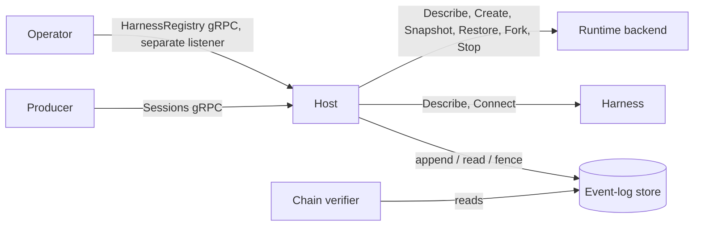
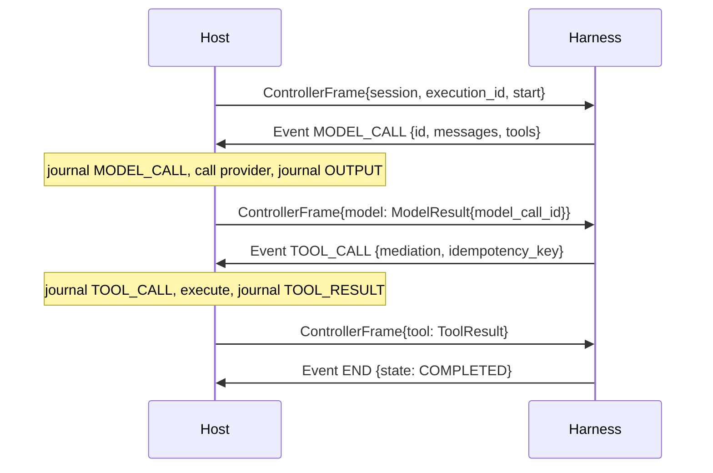

# AgentSessions Protocol Specification

**Status:** Draft

**Version:** `0.2.0-draft`

**Last updated:** October 16, 2026

## Abstract

AgentSessions defines a durable agent session: an append-only, hash-chained event log plus zero or
one live compute incarnation. A client creates a session, runs executions (turns) against it,
suspends and resumes its compute, forks it into children, reads its log back, and can permanently
tombstone it. An agent implementation (a harness) connects through a streaming protocol in which
the host records every model call and host-executed tool call before the harness observes its
result, so a session can be reconstructed from its log without calling the model again.

This specification defines the session model, the event log and its append rules, the canonical
encoding and provenance chain, execution, replay and recovery semantics, tool execution and approval
receipts, the harness wire protocol, the placement gate and runtime contract, the API surface, and
conformance classes. It documents the behavior of the reference implementation at
`github.com/agent-primitives/sessions` on `main`. It does not introduce behavior the reference
implementation lacks.

## 1. Conventions

The key words **MUST**, **MUST NOT**, **REQUIRED**, **SHALL**, **SHALL NOT**, **SHOULD**,
**SHOULD NOT**, **RECOMMENDED**, **NOT RECOMMENDED**, **MAY**, and **OPTIONAL** are to be
interpreted as described in BCP 14 ([RFC 2119](https://www.rfc-editor.org/rfc/rfc2119),
[RFC 8174](https://www.rfc-editor.org/rfc/rfc8174)) when, and only when, they appear in all
capitals.

Requirements carry identifiers such as `LOG-3`. Identifiers are stable within a draft version and
are the unit that reviews and conformance reports cite.

Unless stated otherwise:

- message, field, enum, and RPC names refer to the protobuf package `agentsessions.v1` in
  [`api/`](api/); their field-level reference is [docs/api-reference.md](docs/api-reference.md),
  which this document does not repeat;
- a sequence number (`seq`) is a signed 64-bit integer scoped to one session;
- a hash is lowercase hexadecimal SHA-256 with no algorithm prefix, except where a field is
  defined with a `sha256:` prefix;
- "status code" means a gRPC status code.

### 1.1 Terminology

- **Host**: the process that serves the Sessions API, owns the event log of the sessions it runs,
  and drives harnesses. The reference host is `agentsessionsd` (or `agentctl` in embedded mode).
- **Harness**: an agent implementation that serves the `Harness` service, or the in-process Go
  `api.Harness` interface. It runs one execution per invocation.
- **Producer**: a client of the Sessions API (an issue tracker, chat platform, or application).
- **Runtime**: a compute backend implementing the `api.Runtime` Go interface plus `Describe`
  (§13.3).
- **Session**: a durable resource identified by a `uid`, with an event log and session metadata.
- **Execution** (turn): one invocation of a harness against a session, identified by an
  `execution_id`.
- **Record**: one committed log entry (`LogRecord`): an `Event` plus `seq`, `prev_hash`,
  `content_hash`, and `fence`.
- **Head**: the `seq` of the last committed record of a session; 0 for an empty log.
- **Fence**: a per-session, monotonically issued integer token that identifies the current writer
  (incarnation).
- **Host-owned event**: an event kind only the host may journal: `EVENT_EXECUTION_START`,
  `EVENT_APPROVAL_REQUEST`, `EVENT_APPROVAL_RESULT`, and lifecycle markers.
- **Reconstruction replay**: re-running a harness against recorded effects, as distinct from the
  `Replay` RPC, which only reads records.

## 2. Scope

This draft specifies:

- the session resource, its two-axis state, its deletion state, and its metadata (§5);
- the event log: record shape, event kinds, sequence assignment, compare-and-swap append, fencing
  (§6);
- the canonical encoding and the provenance hash chain, including fork lineage (§7);
- executions, the determinism invariants, reconstruction replay, and crash recovery (§8);
- tool execution modes, receipts, and at-most-once re-drive (§9);
- the durable approval gate for `STATELESS_REPLAY` harnesses (§10);
- the Sessions lifecycle operations, including permanent soft deletion, and their status codes
  (§11);
- the `Harness.Connect` wire protocol (§12);
- placement, resumability tiers, and the runtime contract (§13);
- the operator-facing harness registry (§14);
- the API surface and conformance classes (§15, §16).

## 3. Non-goals

This draft does not specify:

- authentication, authorization, transport security, or tenancy isolation (see §17);
- a storage schema for the event log; the SQLite layout in [`sqlitelog/`](sqlitelog/) is an
  implementation detail;
- erasure of a session's journal or metadata, or reclamation of its compute on deletion:
  `DeleteSession` records durable intent only (§11.8);
- in-flight cancellation (`Cancel` is declared and returns `UNIMPLEMENTED`);
- an HTTP/JSON mapping of the API; the only transport is gRPC;
- a warm (resident) pause; `COMPUTE_WARM` is declared but never reported;
- approval policy, expiry, automatic decisions, or approval for memory-snapshot harnesses;
- any compute, sandbox, cloud, or vendor technology. Backends such as agent-substrate are examples
  of the runtime contract (§13.4), not requirements;
- compaction or retention of the log (`LIFECYCLE_BASELINE` is declared but has no defined
  semantics).

## 4. Conformance classes

| Class | Implements | Sections |
|---|---|---|
| Sessions host | `Sessions` service, controller semantics, harness driving | §5, §6.3 to §6.5, §8 to §12, §13.1 to §13.3, §15 |
| Event-log store | the append, head, fence, read and verify contract | §6, §7 |
| Harness | `Harness` service (`Describe`, `Connect`) or `api.Harness` | §8.4, §9, §10.3, §12 |
| Runtime backend | `api.Runtime` plus `Describe` (§13.3) | §13 |
| Chain verifier | independent recomputation of `content_hash` | §7 |

An implementation MAY claim several classes. Passing one class does not imply another.



## 5. Session model

### 5.1 Resource

- `SES-1`: `CreateSession` MUST assign a new `uid`. A caller-supplied `metadata.uid` is ignored.
  The reference format is `sess-` followed by 24 hexadecimal characters; clients MUST treat the
  `uid` as opaque.
- `SES-2`: `CreateSession` stores only `project`, `name`, `harness`, `model`, `labels`,
  `annotations`, `origin`, and `identity`. Output-only fields in the request (`exec_state`,
  `compute_state`, `pending_approval`, `deletion_state`, `deletion_requested_time`, `last_seq`,
  `parent_uid`, `fork_seq`, `compute`) MUST be ignored.
- `SES-3`: An empty `project` MUST be replaced by the host's default project. An empty `harness`
  MUST be replaced by the host's default harness.
- `SES-4`: `CreateSession` appends no event. A new session reports `last_seq = 0`.
- `SES-5`: `labels`, `annotations`, `origin`, and `identity` MUST be returned unchanged by
  `CreateSession`, `GetSession`, and `ListSessions`, with one exception: an `origin` or
  `identity` that is set but has no populated field is stored as absent and returned unset.
- `SES-6`: `identity` is recorded provenance. A host conforming to this draft MUST NOT treat it as
  an authorization decision (§17).
- `Session.compute` (`ComputeRef`) is not populated by the reference host. The suspend snapshot
  reference is carried on the `LIFECYCLE_SUSPEND` record instead (§13.3).

### 5.2 Two-axis state

A session reports an execution axis (`exec_state`) and a compute axis (`compute_state`). There is
no flattened lifecycle enum.

- `SES-7`: `exec_state` MUST be derived from the log at `last_seq`, by reading it or from a
  projection updated in the same transaction as the append (`LOG-8`), which is what the reference
  host reads. The value is:
  - `EXEC_AWAITING` when a valid, owned, unanswered host approval request exists in the latest
    execution (§10);
  - otherwise `EXEC_PENDING` when the log has no record before its `LIFECYCLE_DELETE` (§11.8),
    which for a session that is not deleted means `last_seq = 0`;
  - otherwise `EXEC_COMPLETED`.

  Deletion leaves this value as it was: a deleted session with a valid unanswered request still
  reports `EXEC_AWAITING`, but without `pending_approval` (`SES-12`).
- `EXEC_COMPLETED` is a compatibility fallback. It does not prove that an `EVENT_END` or a receipt
  exists. The reference host never reports `EXEC_RUNNING`, `EXEC_FAILED`, or `EXEC_CANCELED`.
- `SES-8`: `compute_state` MUST be updated in the same transaction as the append that changes it:
  - `LIFECYCLE_SUSPEND` and `LIFECYCLE_FORK` set `COMPUTE_COLD`;
  - `LIFECYCLE_RESUME` sets `COMPUTE_LIVE`;
  - any non-lifecycle event other than `EVENT_APPROVAL_REQUEST` and `EVENT_APPROVAL_RESULT` sets
    `COMPUTE_LIVE`;
  - `LIFECYCLE_BASELINE`, `LIFECYCLE_CANCEL`, `LIFECYCLE_DELETE`, and approval events leave it
    unchanged;
  - a session with no events reports `COMPUTE_NONE`.
- The reference host never reports `COMPUTE_WARM` or `COMPUTE_TERMINATED`.

### 5.3 Listing

- `SES-9`: `ListSessions` MUST enumerate sessions from durable metadata, including sessions with no
  events. `project` is an exact-match filter; empty selects the default project. A deleted session
  (§5.4) MUST be omitted, and omitted before paging, so it takes no slot of a page.
- `SES-10`: Paging MUST be keyset over `(create_time DESC, uid ASC)`. A `page_token` the host
  cannot parse MUST be `INVALID_ARGUMENT`. `next_page_token` is empty on the last page.
- `SES-11`: A `page_size` of 0 or less selects the server default (50 in the reference host). A
  value above the server maximum (500) is clamped, not rejected.

### 5.4 Deletion state

`deletion_state` is a third axis, independent of `exec_state` and `compute_state`.

- `SES-12`: A session MUST report `DELETION_ACTIVE` until `DeleteSession` commits (§11.8), and
  `DELETION_PENDING` from then on. `deletion_requested_time` is unset while `ACTIVE` and, while
  `PENDING`, is the time the host recorded in the deletion transaction (`OPS-31`). A `PENDING`
  session MUST NOT report `pending_approval`.
- `SES-13`: `PENDING` is a permanent tombstone and durable intent, not a report that compute or
  snapshots were reclaimed (`OPS-35`). No transition leaves it. The reference host never reports
  `DELETION_STATE_UNSPECIFIED`; the internal completion state reserved for cleanup has no wire
  value and is never written.
- `SES-14`: `GetSession` MUST keep returning a deleted session, with its metadata, lineage,
  `last_seq` (which counts the `LIFECYCLE_DELETE` record), and `update_time` (equal to
  `deletion_requested_time` in the reference host).

## 6. Event log

### 6.1 Records

- `LOG-1`: A record MUST consist of `seq`, `prev_hash`, `content_hash`, `fence`, and `event`
  (`LogRecord`). `Event` carries no sequence or hash fields; field numbers 1, 5 and 6 are reserved
  for that reason.
- `LOG-2`: Records are totally ordered per session by `seq`. The first record has `seq = 1`. Each
  append assigns `seq = head + 1`; the caller never chooses `seq`.
- `LOG-3`: `fence` records the token of the writer that appended the record. It is not covered by
  `content_hash` (§7.1).
- `LOG-4`: An event carries `execution_id`, `ts`, `schema_version`, `kind`, `actor`, and at most one
  body. The reference host leaves `schema_version` unset and sets `ts` only on
  `EVENT_APPROVAL_RESULT`, except on `LIFECYCLE_DELETE`, which carries `schema_version = 1` and a
  `ts` equal to `deletion_requested_time` (`OPS-31`); other events carry whatever their producer
  supplied.

### 6.2 Event kinds

| Kind | Body | Written by | Notes |
|---|---|---|---|
| `EVENT_EXECUTION_START` | `ExecutionStart` | host | First record of every new execution (§8.1). |
| `EVENT_INPUT` | `Message` | host | One per input message. |
| `EVENT_MODEL_CALL` | `ModelCall` | host | Recorded before the provider is invoked. Journal form keeps `model`, `params`, `input_hash`, `id`; the reference host records only `model`, `input_hash` and `id`, so `params` is covered by `input_hash` alone (`EXE-11`). |
| `EVENT_OUTPUT` | `Message` | host | The finalized model completion (`EXE-12`), or text the harness emits through `Output`: one `assistant` text record per call (a wire harness's message keeps only its text parts). Streaming deltas (`ExecUpdate.delta`) are never journaled. |
| `EVENT_TOOL_CALL` | `ToolCall` | host | Intent, recorded before a host-executed tool runs. |
| `EVENT_TOOL_RESULT` | `ToolResult` | host | Receipt, or a harness-reported result. |
| `EVENT_APPROVAL_REQUEST` | `ApprovalRequest` | host only | §10. |
| `EVENT_APPROVAL_RESULT` | `ApprovalResult` | host only | §10. |
| `EVENT_USAGE` | `Usage` | host | Per-call usage reported by the harness. |
| `EVENT_LIFECYCLE` | `Lifecycle` | host only | `SUSPEND`, `RESUME`, `FORK`; `DELETE`, written only by `DeleteSession` with an empty `execution_id` (§11.8); `BASELINE`, `CANCEL` declared, unused. |
| `EVENT_END` | `HarnessEnd` | host | Written with `state = "COMPLETED"` on success. |
| `EVENT_ERROR` | `Error` | host | Best-effort record of a failed execution or recovery. |
| `EVENT_PARKED` | `ApprovalRef` | harness | Transport only; never journaled (§10.3). |

- `LOG-5`: A host MUST NOT journal `EVENT_PARKED`. The host-side sink has no operation that
  emits it, and the wire client accepts it only as the park acknowledgement (§10.3) and refuses it
  as an ordinary harness event.
- The reference SQLite store also refuses to append `EVENT_PARKED`. The in-memory reference store
  (`eventlog.Log`) does not check the kind and appends it.
- `LOG-6`: The reference host writes `EVENT_ERROR`, not `EVENT_END`, when an execution fails. It
  never writes `HarnessEnd.state` values other than `COMPLETED`.
- `LOG-18`: `LIFECYCLE_DELETE` MUST be written only by the deletion transaction (`OPS-31`), never
  through `Append`. The reference SQLite store refuses an `Append` of it. The in-memory reference
  store does not check the kind, and has no deletion.

### 6.3 Append and compare-and-swap

- `LOG-7`: `Append(expected_last_seq, fence, event)` MUST commit the event as `seq = head + 1` only
  if `expected_last_seq` equals the current head. Otherwise it MUST fail with a conflict error
  (`eventlog.ErrConflict`) and commit nothing.
- `LOG-8`: The head read, the sequence check, the fence check, the insert, and any projection
  updates (`compute_state`, approval projection) MUST be atomic. Two concurrent appends at the
  same head MUST NOT both commit; if either carries the current fence, exactly one commits. The
  loser fails with the conflict error, or with the fenced error (`LOG-12`) when its fence is stale
  and it reaches the store first.
- `LOG-9`: When both the sequence and the fence are stale, the reference store reports the conflict
  error, because the sequence check runs first.
- `LOG-10`: A host MUST map the conflict error to `ABORTED`.

### 6.4 Fencing

- `LOG-11`: `NewFence` MUST atomically advance and return the session's fence. The first token is
  1. A token of 0 is never minted.
- `LOG-12`: `Append` MUST fail with a fenced error (`eventlog.ErrFenced`) when `fence` is lower than
  the session's current fence, and commit nothing. A host MUST map it to `ABORTED`.
- `LOG-13`: A writer that receives the fenced error has been superseded and MUST NOT retry the
  append. When the fenced error reaches the host, the host MUST end that operation and report
  `ABORTED`.
- In the reference host a fenced append is not sticky in the sink, except for the approval
  request and approval receipt appends (§10). Every later append fails fenced too, so the
  superseded writer journals nothing more. A wire harness's sink errors reach the host unchanged,
  and a harness that returns without error fails on its `EVENT_END` append. An in-process
  `api.Harness` that returns its own error without wrapping the sink error (`%w`) is reported
  `INTERNAL`; to have `ABORTED` reported, it returns the sink error unchanged or wrapped with `%w`.
- The reference store accepts a `fence` equal to or greater than the current fence and does not
  store a greater value as current. For a session with no metadata row, the current fence is 0.
- TODO(spike): Should a store reject a `fence` greater than the last minted value? The reference
  store accepts it and no test pins either behavior.
- `LOG-14`: Every operation that starts writing to a session (Exec, Resume, Suspend, Approve, the
  approval repair in §10.4, Fork children) MUST mint a fresh fence before its first append, so that
  any earlier writer is superseded. `DeleteSession` advances the fence in the same transaction as
  its append (`OPS-31`).
- `LOG-19`: A store that supports deletion MUST refuse `Append` and `NewFence` for a deleted
  session with a deleted error (`eventlog.ErrDeleted`) and commit nothing, whatever the fence and
  cursor, and MUST NOT rewrite a deleted session's metadata. A session with no metadata row is
  writable. The reference SQLite store enforces this and checks deletion first, so a deleted
  session reports the deleted error, not a conflict or fenced error. The in-memory store has no
  deletion. A store MAY also expose a read-only writable check (`CheckWritable`), which the
  reference host runs before any runtime call (`OPS-34`); a wrapper around such a store has to
  forward it to keep that ordering.

### 6.5 Idempotency

- `LOG-15`: `Append` has no idempotency key. A retried append after a successful commit fails with
  the conflict error; it is never deduplicated by the store.
- The Sessions RPCs carry no request id. The exceptions are `Approve` (an exact retry returns the
  existing decision, §10.2) and `RegisterHarness` (idempotent on the spec digest, §14).
- Tool-level deduplication is the executor's responsibility (§9.3).

### 6.6 Reads

- `LOG-16`: `Read(from_seq)` MUST return all records with `seq >= from_seq` in order, with the
  stored `prev_hash` and `content_hash` (not recomputed).
- `LOG-17`: The `Replay` RPC streams committed records only. `from_seq <= 0` reads from 1;
  `to_seq = 0` reads to the head. It never emits deltas and never runs a harness.
- The reference host returns an empty, successful stream for an unknown or empty session on
  `Replay`; it does not return `NOT_FOUND`.
- `Replay` of a deleted session MUST keep returning its records, including `LIFECYCLE_DELETE`.

## 7. Provenance chain and canonical encoding

### 7.1 Canonical form

- `CHAIN-1`: The canonical bytes of an event MUST be the RFC 8785 (JCS) transform of its
  proto3-JSON form, produced with proto field names (not lowerCamelCase), enum values as names,
  and unpopulated fields omitted. Under proto3-JSON, `int64` is a string and `bytes` is standard
  base64.
- `CHAIN-2`: `content_hash` MUST be:

  ```text
  content_hash = lowercase-hex( SHA-256( JCS({
      "event":     <proto3-JSON(Event)>,
      "prev_hash": <prev_hash string>,
      "seq":       <seq as a decimal string>
  }) ) )
  ```

- `CHAIN-3`: The first record of a session MUST use `prev_hash = ""` (the empty string). Every
  later record MUST use the `content_hash` of the record at `seq - 1`.
- `CHAIN-4`: `fence` is outside the hashed envelope. Copying a record into another session with a
  different fence does not change its hash.
- `CHAIN-5`: Fields that are wire-only MUST NOT be in the journal form and therefore are not hashed:
  `ModelCall.messages`, `ModelCall.tools`, and `ModelCall.tool_choice`. The model input is covered
  by `ModelCall.input_hash` instead (§8.3).
- `CHAIN-6`: A zero `ts` is omitted. `optional` fields keep presence: `ExecutionStart.input_count =
  0` is emitted, an absent count is not.
- `CHAIN-7`: Structured content (`google.protobuf.Struct`: tool args, outputs, `DataPart`) is
  JSON-shaped. Integers above 2^53 inside a `Struct` are not exactly representable; producers
  SHOULD NOT put them there.
- Externalized payloads (`FilePart.uri`, `ReasoningPart.opaque_uri`, `ToolResult.output_uri`)
  carry their own digest field, so the chain covers them by reference. The host does not fetch or
  check the referenced bytes.

### 7.2 Fork lineage

- `CHAIN-8`: A fork child MUST contain the parent's records `1..at_seq` with identical `seq`,
  `prev_hash`, `content_hash`, and event, under the child's own fence, followed by a
  `LIFECYCLE_FORK` record whose `prev_hash` is the parent's `content_hash` at `at_seq`. The chain is
  a tree rooted at the first ancestor.
- The reference host writes `Lifecycle.detail = "parent@<at_seq>"`. The parent uid is recorded in
  session metadata (`parent_uid`, `fork_seq`), not in the detail string. When `Fork` returns a
  compute instance (`RT-4h`), the marker records it in `Lifecycle.compute_instance`; an empty one
  is omitted from the canonical bytes, so a marker without it hashes as before.

### 7.3 Verification

- `CHAIN-9`: A verifier MUST walk records from `seq = 1` with expected `prev_hash = ""`, check that
  each record's `prev_hash` equals the expected value, recompute `content_hash` per `CHAIN-2`, and
  report a mismatch of either as tampering.
- `CHAIN-10`: A verifier MUST recompute hashes from the event content, not trust stored hashes.
- Verification proves internal consistency only. Removing records from the end of a log, or
  replacing the whole log, is not detectable from the log alone; detecting it requires an external
  anchor (for example a recorded head hash), which this draft does not define.
- TODO(spike): Define an external head anchor (signed or published head `content_hash`) so that
  tail truncation is detectable.

### 7.4 Golden vectors

- `CHAIN-11`: A chain verifier MUST reproduce the golden vectors pinned in
  [`canon/canon_test.go`](canon/canon_test.go) and [`hack/verify_chain.py`](hack/verify_chain.py)
  (`python3 hack/verify_chain.py --golden`). They cover an output event, three `EXECUTION_START`
  shapes (opaque config with an int64 cursor above 2^53, `input_count` 0, `input_count` 2), and an
  output carrying a tool-call part with `Struct` args, each at `prev_hash = ""` and `seq = 1`.
- `hack/verify_chain.py --journal` audits a SQLite journal end to end with an independent Python
  implementation. `hack/verify_chain.sh` runs it against a recorded journal and against a tampered
  copy, which must fail.
- TODO(spike): The independent verifier is exercised on golden vectors and echo-harness journals.
  The tool-call vector pins one exactly representable float (`1.5`). Parity with the Go encoder is
  not verified for floats that are not exactly representable or that serialize in exponent form
  (for example `0.1`, `1e21`), for negative zero (`-0`, which RFC 8785 serializes as `0`), or for
  timestamps with fractional seconds.

### 7.5 Related digests

- The harness registry's `spec_digest` is `sha256:` followed by the lowercase hex SHA-256 of the
  canonical bytes (`CHAIN-1`) of the `HarnessSpec` message (§14).

## 8. Executions

### 8.1 Execution records

- `EXE-1`: Every new execution MUST begin with a host-written `EVENT_EXECUTION_START` record, before
  any `EVENT_INPUT` or effect. It carries the execution's `config` bytes verbatim,
  `resume_from_seq`, `input_count` (always set, including 0), the host-resolved harness name, the
  harness's advertised `version`, and, when the backend reports one, the compute instance the turn
  was placed on (`compute_instance`, `RT-4h`).
- `EXE-2`: The caller's compare-and-swap cursor (§11.4) applies to the `EXECUTION_START` append. If
  it fails, the harness MUST NOT run.
- `EXE-3`: One `EVENT_INPUT` per input message MUST follow `EXECUTION_START`. Each later append in
  the execution is made at the current head under the execution's fence.
- `EXE-4`: Every event the host appends for an execution MUST carry its `execution_id`, except
  records appended while recovering a legacy execution (§8.7), which carry none. The reference
  host generates a random 16-hexadecimal-character id.
- `EXE-5`: A successful execution MUST end with `EVENT_END` (`state = "COMPLETED"`). A failed
  execution ends with a best-effort `EVENT_ERROR` and no `EVENT_END`. An execution that parked at
  an approval gate (§10) ends with neither.
- `EXE-6`: Outside the legacy execution (§8.7), an execution is complete if and only if it has an
  `EVENT_END`. `EVENT_ERROR` does not complete such an execution; a later recovery may still
  finish it. The legacy execution's completion rule is `EXE-29`.
- `EXE-7`: `Start.history` for a new execution MUST be every event before its `EXECUTION_START`.
  The reference host always sends the full prior log, including after a memory restore.

### 8.2 Effects

The host mediates exactly these harness operations, in the Go SPI as `api.EventSink` and on the
wire as §12 frames: model call, output, tool call, reported tool result, and usage.

- `EXE-8`: The host MUST serialize the sink operations of one execution. After the harness's run
  returns, further sink calls MUST fail.
- `EXE-33`: A failed sink operation reaches the harness as an error it can handle only in the Go
  SPI. An in-process `api.Harness` can handle that error and continue, within `EXE-14` (sticky
  divergence), `APR-2` (a park answers every later call), and `LOG-13` (a fenced writer appends
  nothing more). `ControllerFrame` has no error reply, so over `Harness.Connect` the reference
  host ends the invocation on any sink error other than an approval park: it returns that error
  as the run's result and cancels the stream. The harness's pending call fails with the stream,
  nothing it does afterwards is journaled, and the execution fails (`EXE-5`, `EXE-23`). The rules
  below that return an error to the harness, including `EXE-22`, `EXE-30`, `TOOL-6`, and
  `TOOL-10`, therefore fail the execution of a wire harness. An approval park is the exception:
  the host sends `ControllerFrame.park`, waits for `EVENT_PARKED` and the stream's close, and the
  execution ends parked, not failed (`APR-3`, `APR-10`).
- `EXE-9`: There is no mediated clock or randomness operation. A harness that uses wall-clock time
  or randomness to decide its actions is not reconstructible; this is a harness obligation
  (§8.4), not something the host enforces.

### 8.3 Model calls

- `EXE-10`: On the live path the host MUST append `EVENT_MODEL_CALL` (with `input_hash` and a fresh
  call id) before invoking the provider, then append the completion as `EVENT_OUTPUT`. The
  `OUTPUT` carries no call id; its position after the `MODEL_CALL` is the correlation.
- `EXE-11`: `input_hash` MUST cover the full model request: model, messages, params, tool
  definitions, and tool choice. In the reference host it is SHA-256 over the Go JSON encoding of
  `api.ModelRequest`, with later-added fields omitted when empty so older hashes stay stable. It is
  host-internal: only the host that wrote it is required to reproduce it.
- TODO(spike): `input_hash` is not language-neutral. Should it be redefined over canonical bytes
  (`CHAIN-1`) so a journal written by one host implementation can be replayed by another?
- `EXE-12`: Model streaming deltas (`ExecUpdate.delta`) MUST NOT be journaled. Exactly one
  `EVENT_OUTPUT` records each finalized completion. Text a harness passes to `Output` is not a
  delta: each call is journaled as its own `EVENT_OUTPUT`.

### 8.4 Determinism invariants

These are named in the reference controller. The numbering is the code's.

- `I0`: On reconstruction replay, each model call the harness re-issues MUST have the same
  `input_hash` as the recorded `MODEL_CALL` at that position, its output text MUST equal the
  recorded `OUTPUT` text, and reported usage MUST equal the recorded `USAGE` (except in the legacy
  execution, `EXE-32`). Any mismatch is divergence (`ErrReplayDiverged`).
- `I1`: Reconstruction replay MUST NOT invoke the model provider or the tool executor. Recorded
  completions and receipts are served from the log.
- `I3`: A host-executed tool intent recorded without a receipt is re-driven on recovery under the
  same recorded call and idempotency key (§9.3).
- `EXE-13`: A harness MUST be deterministic given its `Start` (config, history, inputs, cursor) and
  the served model and tool results. A harness MUST replay `ReasoningPart` content verbatim.
- `EXE-14`: Divergence MUST be sticky: once detected, every later sink operation in that execution
  fails with the same error, and the execution fails even if the harness swallowed the error.
- `EXE-15`: A reconstruction that consumes fewer recorded effects than the execution recorded MUST
  fail as divergence.

### 8.5 Reconstruction replay

- `EXE-16`: Events MUST be grouped into executions by `execution_id` in first-seen order.
  Lifecycle events are skipped. Any other event without an `execution_id` after the legacy prefix
  (§8.7) is an invalid log.
- `EXE-17`: Reconstruction replay re-runs only completed executions and appends nothing. Failed or
  unfinished executions remain visible in later executions' history. The legacy execution (§8.7)
  is the exception: a log that is only a legacy prefix is replayed whole even if unfinished, and a
  legacy prefix followed by modern executions is replayed up to its last `END` (not at all if it
  has none; an `ERROR` does not count here, unlike `EXE-29`). `EXE-32` defines how the legacy
  execution is replayed.
- `EXE-18`: Before running any harness, reconstruction MUST check every selected execution's
  recorded harness identity (§8.6) and input completeness (§8.6).
- `EXE-19`: Inputs, config, and `resume_from_seq` MUST come from the journal, not from the caller.

### 8.6 Recovery (Resume)

- `EXE-20`: Recovery MUST select the latest execution. If the log has no execution (it is empty or
  holds only `LIFECYCLE` records) or that execution is complete (`EXE-6`; for the legacy
  execution, `EXE-29`), recovery is a no-op: it performs no harness identity check and no
  `Describe` of its own. `Resume`'s admission (`RT-1`) still runs before recovery.
- `EXE-21`: Recovery serves recorded effects as in §8.5 until they are exhausted, then switches to
  the live path for new effects only.
- `EXE-22`: Model cut rule, outside legacy recovery (`EXE-30`): if the trailing effect is a
  `MODEL_CALL` with no `OUTPUT` and the re-issued `input_hash` matches, recovery MUST invoke the
  provider once and append the `OUTPUT` after the existing `MODEL_CALL`. A hash mismatch is
  divergence: the provider is not called and no `OUTPUT` is appended (the failed run's
  `EVENT_ERROR`, `EXE-23`, still applies). A non-trailing `MODEL_CALL` without `OUTPUT` MUST NOT
  reach the provider: the re-issued call returns an error to the harness, which is not
  divergence. The execution fails only if the harness does not handle that error; over
  `Harness.Connect` it always fails (`EXE-33`).
- `EXE-23`: Recovery that fails after the harness has started running appends a best-effort
  `EVENT_ERROR`; recovery that succeeds appends `EVENT_END`. Failures raised before the harness
  runs (invalid log, incomplete invocation `EXE-24`, harness identity `EXE-25`, inherited intent
  `EXE-26`, an unfinished legacy execution without a session uid `EXE-30`) append nothing. A run
  stopped after an approval intent is recorded (a park, or a failure recording the approval
  request or receipt, §10) appends neither `ERROR` nor `END`.
- `EXE-24`: Input completeness, for an execution that has an `EXECUTION_START`: a missing or
  negative `input_count`, an `EVENT_INPUT` with no message, or a count different from the
  committed `EVENT_INPUT` records is an invalid log for a completed or selected execution. A
  trailing execution with fewer inputs than `input_count` is incomplete
  (`ErrIncompleteInvocation`). Both MUST be raised before the harness runs. An execution without
  an `EXECUTION_START` (§8.7) has no completeness check.
- `EXE-25`: Harness identity: a non-empty recorded `ExecutionStart.harness` MUST equal the name the
  host resolved for this run. A non-empty recorded `harness_version` MUST equal the served
  `HarnessDescriptor.version` exactly, and an empty served version is a mismatch. An empty recorded
  version imposes no check.
- `EXE-26`: Recovery of a fork child MUST refuse an unresolved tool intent copied from before the
  child's `LIFECYCLE_FORK` (`ErrInheritedToolIntent`, `FAILED_PRECONDITION`), before `Describe`,
  run, or any append.
- TODO(spike): The code labels Resume recovery as invariant `I4`; docs/architecture.md and
  docs/concepts.md use `I4` for "memory restore is not replay" and add an `I5`. Which numbering is
  authoritative?

### 8.7 Legacy journals

v0.1.x hosts journaled no `execution_id` and no `EXECUTION_START`. The reference host reads those
journals by the rules below, which differ from §8.1-§8.6. They also differ from v0.1.x recovery:
v0.1.x `Resume` treated a turn as complete only when an `END` followed its last `INPUT`, so it
re-ran a turn that had ended in `ERROR`. `EXE-29` treats that `ERROR` as completing the legacy
execution, so `Resume` is a no-op for it. A harness invocation for a legacy execution
(reconstruction, or recovery of an unfinished one) also needs a session uid (`EXE-30`, `EXE-32`
and the wire execution id below), which v0.1.x did not. `Resume` of a complete legacy execution
invokes no harness and stays a no-op without one.

- `EXE-27`: The records at the start of the log, up to the first `EXECUTION_START` or the first
  non-`LIFECYCLE` record that carries an `execution_id`, MUST be read as one legacy execution if
  any of them is not `LIFECYCLE`. Only `INPUT`, `MODEL_CALL`, `OUTPUT`, `TOOL_CALL`,
  `TOOL_RESULT`, `USAGE`, `END`, `ERROR`, and interleaved `LIFECYCLE` are allowed in it; any other
  kind is an invalid log. A log that holds only `LIFECYCLE` records has no execution.
- `EXE-28`: If the legacy execution's last non-`LIFECYCLE` record is neither `END` nor `ERROR`
  (an unfinished legacy tail), the record that ends it MUST be an `EXECUTION_START`; any other
  record with an `execution_id` there is an invalid log. Reconstruction, recovery, and `Exec`
  raise it before the harness runs and append nothing; `Exec` and `Resume` fail
  `FAILED_PRECONDITION`. An `EXECUTION_START` supersedes an unfinished legacy tail: `Exec` on such
  a log starts a new execution and never recovers the tail.
- `EXE-29`: Recovery selects the legacy execution only when no modern record follows it. For
  recovery, the legacy execution is complete if it has no `INPUT`, or if an `END` or an `ERROR`
  follows its last `INPUT`; recovery of a complete legacy execution is a no-op (`EXE-20`). An
  `ERROR`, including one appended by a failed legacy recovery, therefore ends the legacy
  execution, and a later `Resume` does not retry it.
- `EXE-30`: Recovery of an unfinished legacy execution MUST use only its last `INPUT` as
  `Start.inputs` and every record before that `INPUT` as `Start.history`, with empty `config` and
  `resume_from_seq` 0. It serves the `MODEL_CALL`, `OUTPUT`, `TOOL_CALL`, and `TOOL_RESULT`
  records after that `INPUT` as in §8.5 and re-drives a trailing tool intent (`TOOL-10`). It
  differs from modern recovery as follows:
  - Recorded `USAGE` is not an effect. Served completions carry no usage, and a harness `Usage`
    call is accepted without comparison while recorded effects remain and journaled after they
    are exhausted.
  - A trailing `MODEL_CALL` without `OUTPUT` is not re-driven (`EXE-22` does not apply): the
    re-issued call returns an error to the harness and the provider is not called. If the run
    then fails (over `Harness.Connect` it always does, `EXE-33`), its `ERROR` completes the
    legacy execution (`EXE-29`).
  - A `REQUIRES_APPROVAL` tool call that passes `APR-1` is refused (`ErrInvalidApprovalCall`)
    before any append; `APR-2` does not apply.
  - Records it appends carry no `execution_id` (`EXE-4`).
  - Without a session uid it fails (`ErrMissingSessionUID`) before the harness runs and appends
    nothing.
- `EXE-32`: Reconstruction runs the replayed legacy prefix (`EXE-17`) as one invocation, as v0.1.x
  did: `Start.inputs` is every legacy `INPUT` in it, `Start.history` is that prefix itself, and
  `config` and `resume_from_seq` are empty. Recorded `USAGE` is neither served nor compared. A
  legacy log with more than one turn can therefore fail reconstruction as divergence.
- The reference host derives a wire execution id for a legacy execution
  (`legacy-` + hex SHA-256 over the session uid, `seq`, and canonical event) and never journals it.
  Reconstruction derives it from the first legacy `INPUT` (or the first non-`LIFECYCLE` record
  when there is none); recovery derives it from the last `INPUT`, so retries keep the same id.
  Without a session uid, reconstruction fails like recovery of an unfinished legacy execution
  (`EXE-30`).
- `EXE-31`: An execution whose records carry an `execution_id` but that has no `EXECUTION_START`
  (written by unreleased hosts between v0.1.2 and the start marker) is otherwise a modern
  execution: `EXE-6` decides completion and §8.6 applies. It is read with defaults: empty
  `config`, `resume_from_seq` 0, no recorded harness identity (`EXE-25` imposes no check;
  recovery routes as in `OPS-8`), and no input-completeness check (`EXE-24`). An
  `EXECUTION_START` that is not the first record of its execution, or that has no payload, is an
  invalid log.

## 9. Tool execution and receipts

### 9.1 Modes

| `Mediation` | Who executes | What the host records |
|---|---|---|
| `MEDIATION_CONTROLLER_MEDIATED` | host executor | `TOOL_CALL` intent, then `TOOL_RESULT` receipt |
| `MEDIATION_REQUIRES_APPROVAL` | host executor, after a decision | `TOOL_CALL`, `APPROVAL_REQUEST`, decision, receipt (§10) |
| `MEDIATION_IN_HARNESS_REPORTED` | harness | `TOOL_RESULT` only, as reported |

- `TOOL-1`: The tool-call effect MUST accept only `CONTROLLER_MEDIATED` and `REQUIRES_APPROVAL`.
  `UNSPECIFIED`, `IN_HARNESS_REPORTED`, or an unknown value MUST be rejected
  (`ErrUnmediatedToolCall`) before anything is recorded. There is no defaulting of an unset
  mediation.
- `TOOL-2`: A harness that executes a tool itself MUST report the result as `EVENT_TOOL_RESULT`
  (`Report` in the Go SPI). The host appends it as given, records no intent, and sends no reply.
- `TOOL-3`: A reported result MUST NOT carry approval sequence numbers and its `code` MUST be
  `CODE_UNSPECIFIED` or `EXECUTOR_ERROR`; it MUST NOT target an approval-gated call id.

### 9.2 Host-executed tools

- `TOOL-4`: A host-executed call MUST carry a non-empty `idempotency_key`. A call without one MUST
  be rejected (`ErrMissingIdempotencyKey`) before `TOOL_CALL` is recorded.
- `TOOL-5`: The host MUST append `TOOL_CALL`, then call the executor with the session uid as scope,
  then append `TOOL_RESULT` with `id` set to the call id. A host MUST NOT run a tool executor
  without a non-empty session uid.
- `TOOL-6`: For an ordinary host-executed call, an executor that returns a transport error leaves
  the intent without a receipt; the error is returned to the harness (over `Harness.Connect` it
  ends the invocation, `EXE-33`) and no `TOOL_RESULT` is written. An approved
  `REQUIRES_APPROVAL` call is different: an executor error becomes a durable receipt with
  `code = EXECUTOR_ERROR` and `is_error` set (§10).
- A reference host with no tool executor configured records `TOOL_CALL`, then fails the call ("no
  tool executor configured") and the execution ends with `EVENT_ERROR`. The intent stays without a
  receipt, as in `TOOL-6`.
- `TOOL-7`: An ordinary receipt MUST NOT carry approval fields, and its code MUST be
  `CODE_UNSPECIFIED` or `EXECUTOR_ERROR`.

### 9.3 At-most-once and re-drive

- `TOOL-8`: On reconstruction or recovery, a re-issued call MUST match the recorded `TOOL_CALL` in
  `id`, tool name, mediation, `idempotency_key`, and normalized args, or fail as divergence before
  any effect. Args the journal form cannot represent are divergence.
- `TOOL-9`: A recorded call with a receipt MUST be answered from the receipt; the executor MUST NOT
  be called. A receipt whose `id` differs from the call is divergence.
- `TOOL-10`: A trailing `TOOL_CALL` without a receipt MUST be re-driven on recovery with the
  recorded call (same `idempotency_key`) and the same session uid. A non-trailing `TOOL_CALL`
  without a receipt MUST NOT be re-executed: the re-issued call returns an error to the harness,
  which is not divergence. The execution fails only if the harness does not handle that error; an
  in-process harness that handled it originally can continue and complete. Over
  `Harness.Connect` the execution fails (`EXE-33`).
- `TOOL-11`: The executor MUST deduplicate on (session uid, `idempotency_key`) and MUST NOT repeat
  the external effect for a key it has already applied. The host re-drives on every recovery that
  finds the intent unresolved, so at-most-once holds only if the executor deduplicates.
- `TOOL-12`: `idempotency_key` is unique only within a session. Inherited intents across a fork are
  refused (`EXE-26`) rather than re-driven in the child.
- `IN_HARNESS_REPORTED` tools have no intent record and therefore no host re-drive or at-most-once
  guarantee. On reconstruction a reported result consumes the next recorded `TOOL_RESULT` without
  comparing its content.
- TODO(spike): Should reconstruction compare a re-reported `IN_HARNESS_REPORTED` result with the
  recorded one, as it does for output text?

## 10. Approvals

### 10.1 Gate

- `APR-1`: The approval gate applies only to `STATELESS_REPLAY` harnesses. A `REQUIRES_APPROVAL`
  call from any other harness MUST be refused before an effect (`ErrApprovalUnavailable`).
- `APR-2`: A live `REQUIRES_APPROVAL` call MUST have a non-empty, unused call id and a non-empty
  `idempotency_key`. The host MUST append `TOOL_CALL`, then `APPROVAL_REQUEST{tool_call_id}`, then
  park the execution. Every later sink call in that execution returns the park.
- `APR-3`: A parked execution MUST append neither `EVENT_END` nor `EVENT_ERROR`. The host then
  closes the harness connection, takes an external snapshot (§13.3), and appends
  `LIFECYCLE_SUSPEND` under the execution's fence before reporting success.
- `APR-4`: Only the host MAY write `APPROVAL_REQUEST` and `APPROVAL_RESULT`. A harness that emits
  either, or `EXECUTION_START`, or an unsolicited `EVENT_PARKED`, MUST fail the execution.

### 10.2 Decisions

- `APR-5`: `Approve` MUST be `INVALID_ARGUMENT` when `session`, `execution_id`, or `tool_call_id`
  is empty, `request_seq <= 0`, or `approved` is absent. An unknown session is `NOT_FOUND`.
- `APR-6`: A decision MUST target the selected request: the last gated call of the latest
  execution, owned by this session (not copied before a `LIFECYCLE_FORK`), not completed, and
  without a receipt. Otherwise `FAILED_PRECONDITION`.
- `APR-7`: An exact retry (same tuple, `approved`, `reason`, and identity) MUST return the existing
  `APPROVAL_RESULT` record and append nothing, even after resolution, unless the session is
  deleted (`OPS-34`). A changed decision MUST be `FAILED_PRECONDITION` and never overwrites.
- `APR-8`: A new decision MUST mint a fence and append `APPROVAL_RESULT{tool_call_id, approved,
  reason, request_seq}` with `Event.actor` set from the request's identity, at the head observed
  when the request was selected.
- `APR-9`: `Approve` MUST NOT resume compute or call the executor. The caller calls `Resume`.
- No policy hook, expiry, automatic decision, or authorization applies to decisions.

### 10.3 Wire handshake

- `APR-10`: While a request is unresolved, the host sends `ControllerFrame.park` with the
  `ApprovalRef`. The harness MUST check the session, execution, call, and `request_seq > 0`, stop
  the run, send exactly one matching `EVENT_PARKED`, and close its sending side without
  `EVENT_END`. The host MUST treat anything else as a failed exchange; the durable request remains
  recoverable.
- `APR-11`: On decided recovery or replay, the host MUST send `ControllerFrame.approval` before the
  correlated `ControllerFrame.tool` receipt, even when the receipt already exists.
- `APR-12`: Receipt rules, enforced by both sides:
  - `approval_request_seq` equals the decision's `request_seq`, and `approval_decision_seq > 0`
    identifies the committed decision in the same session;
  - a denial is `APPROVAL_DENIED` with `is_error = true`, and the executor MUST NOT have been
    called;
  - an approval is `CODE_UNSPECIFIED` with `is_error = false`, or `EXECUTOR_ERROR` with
    `is_error = true`.

### 10.4 Recovery

- `APR-13`: `Resume` (or input-less `Exec`, §11.4) on an owned gate with no decision MUST return
  the current session without runtime IO. If only `TOOL_CALL` was committed before a crash, the host
  MUST first mint a fence and append the missing `APPROVAL_REQUEST`. When that turn ran on an
  override (`OPS-7`) and its backend has `memory_snapshot`, the host first runs admission (`RT-1`)
  on the override's harness, before the fence: an admission error fails the call, and a
  `REQUIRES_MEMORY_SNAPSHOT` harness is `FAILED_PRECONDITION`.
- `APR-14`: After a decision, recovery MUST use the recorded invocation (harness, config, inputs,
  cursor) and snapshot reference. A denial writes an `APPROVAL_DENIED` receipt without calling the
  executor. An approval calls the executor with the recorded call; an executor failure becomes a
  durable `EXECUTOR_ERROR` receipt. A missing executor is `FAILED_PRECONDITION` and leaves the
  decision recoverable.
- `APR-15`: An inherited unresolved gate (copied by a fork) MUST be refused with
  `FAILED_PRECONDITION`. A reference inherited through fork cannot authorize an effect in the child.
- Requests and snapshots are retained indefinitely.

## 11. Session lifecycle operations

### 11.1 Concurrency

- `OPS-1`: A host MUST serialize, per session, `Exec`, `Resume`, `Suspend`, and `Approve`. An
  overlapping call MUST fail with `ABORTED` without changing compute or the journal. The reference
  guard is non-blocking.
- `OPS-30`: A host MUST also exclude `DeleteSession` from each of those operations and from a
  `Fork` of the same session, both ways: the call that arrives second fails `ABORTED` without
  writing. In the reference host the exclusion is per `Registry` (one host). For `Exec`,
  `Resume`, `Suspend`, and `Approve` it covers two phases: the session lookup and routing, and
  the guarded operation (`OPS-1`). A deletion can commit between the two; `OPS-34` covers that
  case. For `Fork` it covers the lookup, and separately the fan-out until it ends, including
  any rollback (`OPS-27`). A deletion can commit after the fan-out ends, while the host records
  the children's metadata. The children still stand, because the fan-out completed before the
  deletion; the fork returns them if those later metadata writes succeed. Lookup phases and
  `Fork` do not exclude each other or the operations in `OPS-1`. `DeleteSession` neither waits
  for nor cancels the holder; the caller retries.
- `OPS-2`: A per-session checkpoint mark MUST be held by `Suspend`, `Approve`, an approval park
  handoff, a cursor-checked `Resume` while it mints each fence and re-reads the head (`OPS-29`),
  and a `REQUIRES_MEMORY_SNAPSHOT` fork from checkpoint until its last child is cloned.
  A second checkpoint holder MUST fail with `ABORTED`. `Exec` and `Resume` during a checkpoint
  MUST fail with `ABORTED` unless a check the host runs before the mark check fails or answers
  the call. The reference host checks the mark only after the session guard (`OPS-1`), the
  deletion check (`OPS-34`), the request and harness checks (§11.3), the approval-state checks
  (`APR-13`, `APR-15`, `OPS-14`), admission (`RT-1`) and, on `Resume`, the head check (`OPS-29`)
  and the snapshot lookup; an error from those is returned instead of `ABORTED`.
  A `Resume` or input-less `Exec` on an owned gate with no decision (`APR-13`) is answered before
  the check. Its call-only repair takes the mark only for a `Resume` with `expected_last_seq` set
  (`OPS-29`); otherwise it can append `APPROVAL_REQUEST` under a new fence during a checkpoint.
  TODO(spike): Should the call-only approval repair refuse with `ABORTED` during a checkpoint?
- `OPS-3`: A `REQUIRES_MEMORY_SNAPSHOT` fork MUST end any in-flight execution on the parent; that
  execution fails with `ABORTED`.
- `CreateSession`, `GetSession`, `ListSessions`, and `Replay` take no guard. `Fork` (either tier)
  does not take the `OPS-1` session guard, only the deletion exclusion (`OPS-30`). A
  `REQUIRES_MEMORY_SNAPSHOT` fork holds the checkpoint mark instead (`OPS-2`).

### 11.2 Create, Get, List

- See §5. `GetSession` with an empty `uid` is `INVALID_ARGUMENT`; an unknown `uid` is `NOT_FOUND`.
  A deleted session is returned (`SES-14`) and is not listed (`SES-9`).
- `OPS-4`: `CreateSession` with a harness the host does not know is `INVALID_ARGUMENT`. A known but
  unservable registered harness is `FAILED_PRECONDITION`, refused when the name is resolved, before
  the insert. A retired registered harness, or a static harness name that also has a registration
  row, is `FAILED_PRECONDITION`, checked in the same transaction as the insert.

### 11.3 Harness selection

- `OPS-5`: `ExecRequest.harness` empty selects the session's stored harness. A different name runs
  that execution only; the stored harness does not change, and `EXECUTION_START.harness` records
  the resolved name.
- `OPS-6`: If either the stored harness or the override is a registered harness (§14), a differing
  override MUST be `FAILED_PRECONDITION` (the session is pinned). This check runs before the
  override is resolved.
- `OPS-7`: An override that resolves to another registry entry than the session's stored harness
  MUST be `FAILED_PRECONDITION` (`placement.ErrStatefulOverride`) when either harness is
  `REQUIRES_MEMORY_SNAPSHOT`, before any compute is provisioned, fence minted, or record written.
  `Suspend` and `Fork` follow the stored harness, so they would not checkpoint or clone a
  memory-tier override's memory, and parking only an override cannot checkpoint a memory-tier
  stored harness. An alias of the stored harness's entry is not an override. The reference host
  checks the stored harness's half while routing, by `Describe` on the stored harness when its
  runtime has `memory_snapshot`, and the override's half on the descriptor admission reads
  (`RT-1`), again on the turn's connection for a live-describing backend (`RT-3`). Recovery of a
  turn recorded on an override (`OPS-8`) applies both halves.
- `OPS-8`: Recovery (`Resume`, input-less `Exec` recovery) MUST route by the recorded
  `EXECUTION_START.harness`. A recorded name the host does not serve is `FAILED_PRECONDITION`, with
  no fallback. With no recorded name (a legacy or markerless execution, §8.7; an empty `harness`;
  or a journal with nothing to recover), `Resume` routes to the session's stored harness, or to the
  host's default when the session has none.

### 11.4 Exec

- `OPS-9`: An empty `ExecRequest.session` MUST create a session first (as `CreateSession` with only
  `harness` set) and run against it.
- `OPS-10`: An unknown session is `NOT_FOUND`, except that a non-empty harness override on an
  unknown session is checked first: an unknown name is `INVALID_ARGUMENT` and a known but
  unservable registered harness is `FAILED_PRECONDITION`.
- `OPS-11`: The first frame of a stream that sends any frame MUST be `ExecUpdate.session` with the
  session as it was before the turn. Committed records and deltas follow. A caller MUST read the
  stream to completion. Whether an error arrives before or after that frame depends on the path:
  - Both paths: an overlap with `DeleteSession` (`OPS-30`, `ABORTED`) and a session deleted
    before the lookup (`OPS-34`, `FAILED_PRECONDITION`) end the stream with no frame. A deletion
    that commits after the lookup fails the call after the frame (`OPS-34`).
  - Ordinary execution: the host resolves the session and routes the harness before the frame.
    Auto-create failure, an approval-inspection failure, the approval block (`OPS-14`), every
    session lookup or routing error, a journal head read failure, and a failure to materialize
    the session for the frame end the stream with no frame. Routing errors include an unknown
    session or harness (`OPS-10`), the pin (`OPS-6`), and the stored harness's half of the
    memory-tier override check (`OPS-7`), which runs `Describe` on the stored harness and can fail
    `UNAVAILABLE`, `FAILED_PRECONDITION`, or with a context error. Placement admission (`RT-1`:
    `Describe`, descriptor id, `CanPlace`, and the override's half of `OPS-7`),
    `expected_last_seq` (`OPS-13`), and the run itself fail after the frame.
  - Input-less approval recovery (`OPS-14`): only the session lookup, the approval inspection,
    the journal head read, and materializing the session for the frame precede it. Routing by the
    recorded harness (`OPS-8`), the pin, the memory-tier override check, the deadline,
    `expected_last_seq`, and recovery itself fail after the frame.
- `OPS-12`: On an approval park or input-less recovery, the host MUST send a final
  `ExecUpdate.session` frame with the latest cursor and `pending_approval` before closing the
  stream with OK. A park is not a terminal `END` or `ERROR`.
- `OPS-13`: `expected_last_seq` has explicit presence. When set (including 0, which asserts an
  empty log), the `EXECUTION_START` append MUST use it as the compare-and-swap cursor; a mismatch
  is `ABORTED`. When unset, the host uses the head it read when it accepted the request, so an
  append by another writer between that read and `EXECUTION_START` is still `ABORTED`.
- On an ordinary execution, the reference host checks `expected_last_seq` at the append, after
  runtime creation, `Describe`, and fence minting. On the input-less approval recovery path it is
  checked under the session guard before runtime IO or repair.
- `OPS-14`: While the session owns an approval call without a receipt, `Exec` with inputs MUST be
  `FAILED_PRECONDITION`, including after a decision. `Exec` without inputs on a current,
  non-terminal approval-bearing execution MUST recover it via the recorded invocation (§10.4)
  without a new `EXECUTION_START`; request `harness`, `config`, and `resume_from_seq` are ignored.
  Other input-less `Exec` calls start a new execution.
- `OPS-15`: `config` bytes and a non-zero `resume_from_seq` MUST be journaled in `EXECUTION_START`
  before the harness runs. `config` is durable and exposed by `Replay`; it MUST NOT carry
  credentials. The host does not interpret `resume_from_seq`.
- `OPS-16`: `deadline_unix > 0` bounds the execution. A deadline that expires during admission is
  `DEADLINE_EXCEEDED`.

### 11.5 Suspend

- `OPS-17`: `Suspend` MUST call the runtime's `Snapshot(EXTERNAL)`, then mint a fence and append
  `LIFECYCLE_SUSPEND` carrying the returned `SnapshotRef` at the current head. It takes no
  caller cursor. `compute_state` becomes `COMPUTE_COLD`.
- `OPS-18`: `Suspend` routes to the stored harness, except that an owned unreceipted approval routes
  to its recorded harness (`OPS-8`).
- The reference host accepts `Suspend` on a session that is already cold or has never run, and
  appends another `SUSPEND`. `Resume` without a prior `Suspend` is also accepted. The host does not
  check either case itself; whether the call succeeds is up to the backend (`RT-4b`, `RT-4c`). With
  `runtime/local` and `runtime/remote` both succeed. With `runtime/substrate`, both fail when no
  actor exists for the session uid, for example a fresh session before any `Create` reached
  `CreateActor` (a fork child gets its actor from `Fork`): `SuspendActor` and `ResumeActor` return
  `NOT_FOUND` and no marker is appended. For a `REQUIRES_MEMORY_SNAPSHOT` harness the backend
  reports that as `api.ErrMemoryStateLost`, which the reference session service reports as
  `FAILED_PRECONDITION`; for a `STATELESS_REPLAY` harness the service reports `INTERNAL` (§13.4). A
  failed `Exec` does not imply that case: when `Create` succeeded and the dial or turn failed, or
  `CreateActor` succeeded and `Create`'s `ResumeActor` failed, the actor remains, since the host
  calls no `Stop` (`RT-7`), and a later `Suspend` or `Resume` reaches it. `agentsessionsd` itself
  does not build substrate placements (`REG-2a`).
- TODO(spike): Should a repeated `Suspend`, or `Resume` without a prior `Suspend`, be refused or be
  a no-op? Current behavior appends a marker each time the backend call succeeds, and no test pins
  it.

### 11.6 Resume

- `OPS-19`: `Resume` MUST, in order: admit the harness (§13.2), restore from this session's own
  latest `SUSPEND` snapshot reference (one inherited from a parent is skipped; with none, it uses
  `{local: uid}`), open the harness client, mint a fence, run recovery (§8.6), and append
  `LIFECYCLE_RESUME` at the current head. A cursor-checked `Resume` (`OPS-29`) also mints an
  early fence after admission and before restore.
- `OPS-20`: `ResumeRequest.boot` is deprecated and ignored.
- `OPS-29`: `ResumeRequest.expected_last_seq` has explicit presence. When unset, `Resume` performs
  no cursor check. When set (0 asserts an empty journal), the host MUST compare it with the journal
  head and fail with `ABORTED` on a mismatch; the reference host's message names both values. The
  comparison runs at each of these points that the call reaches:
  - under the session guard, before approval inspection, harness resolution, and invocation
    validation, so a moved head is reported ahead of `EXE-24`, `EXE-26`, and routing errors;
  - after the fence minted for an approval repair (`APR-13`), before the missing
    `APPROVAL_REQUEST` is appended; an undecided approval whose request is committed needs no
    fence and gets only the first check;
  - after an early fence minted after admission and before restore;
  - after the turn's regular fence, minted once the harness client is open, before the harness
    runs.
- A refusal at the first check mints no fence and performs no runtime IO. A refusal after a fence
  leaves that fence minted, so older writers are superseded (`LOG-12`) even though `Resume` refused.
  A refusal at the last check may already have restored compute, but the harness does not run and
  nothing is appended.
- `expected_last_seq` is not an execution lease and does not make tool execution exactly-once: it
  cannot cancel effects already in flight, and a later writer can still supersede the `Resume`.
- Approval cases are in §10.4.

### 11.7 Fork

- `OPS-21`: A `ForkRequest.identity` that is present, including an empty message, MUST be
  `INVALID_ARGUMENT` before any other check or side effect.
- `OPS-22`: `count > 128` MUST be `INVALID_ARGUMENT`. `count <= 0` is treated as 1. `child_names`
  MUST have 0 or exactly `count` entries, else `INVALID_ARGUMENT`.
- `OPS-23`: `at_seq <= 0` selects the head.
- `OPS-24`: `STATELESS_REPLAY` fork: the parent is untouched. Per child, the host calls
  `Runtime.Fork` with `{local: parent uid}`, copies the parent's records `1..at_seq` (`CHAIN-8`)
  under a new child fence, and appends `LIFECYCLE_FORK`. The child's `compute_state` is
  `COMPUTE_COLD`.
- `OPS-25`: `REQUIRES_MEMORY_SNAPSHOT` fork: `at_seq` other than the head MUST be
  `FAILED_PRECONDITION` before any side effect. The host then takes the checkpoint mark, fences the
  parent, ends its open streams, re-checks the head (moved is `ABORTED`), snapshots once, appends
  `SUSPEND` to the parent with compare-and-swap at `at_seq`, and clones every child from that one
  snapshot. A snapshot without an external handle is `FAILED_PRECONDITION`; the parent's `SUSPEND`
  remains committed.
- `OPS-26`: Children inherit `project`, `harness`, `model`, `annotations`, and `origin`. `labels`
  come from the request only (never merged). `name` is `child_names[i]` or empty. `identity` is
  unset. `parent_uid` and `fork_seq` record lineage. Children are returned in creation order.
- `OPS-27`: If the fan-out fails, the host MUST call `Runtime.Stop` best-effort on each child it
  provisioned and return the mapped error.
- TODO(spike): A failed fork can leave child journal rows that list in the default project, and a
  stateless fork with `at_seq` above the head records the requested `fork_seq` while copying only
  to the head. Should fork be all-or-nothing in the journal, and should `at_seq > head` be refused?

### 11.8 Delete and Cancel

`DeleteSession` is permanent soft deletion: it tombstones the `uid` and records durable intent. It
does not erase data or reclaim compute.

- `OPS-31`: `DeleteSession` with an empty `uid` MUST be `INVALID_ARGUMENT`. An unknown `uid` MUST
  be `NOT_FOUND` and MUST NOT create a session or journal. On a `DELETION_ACTIVE` session the host
  MUST, in one transaction: append a host-owned `LIFECYCLE_DELETE` record with an empty
  `execution_id` at the current head (`seq = head + 1`, chained per `CHAIN-3`), advance the
  session's fence, set `deletion_state = DELETION_PENDING` and `deletion_requested_time`, and move
  `last_seq` and `update_time`. It takes no caller cursor. It returns the session as committed.
  The record's `ts` and `deletion_requested_time` are the same instant (`LOG-4`).
- `OPS-32`: `DeleteSession` on a session that is already deleted MUST return the stored session
  and write nothing: no record, and no change to the fence, timestamps, `update_time`, or the
  compute projection. A caller whose reply was lost after the commit learns the outcome this way
  or from `GetSession`; the commit cannot be undone.
- `OPS-33`: Deletion is permanent. The `uid`, its metadata, and its journal are retained, no
  operation returns the session to `DELETION_ACTIVE`, and the `uid` is not reused (`SES-1`).
  `GetSession` (`SES-14`) and `Replay` (§6.6) keep working; `ListSessions` omits the session
  (`SES-9`). Children are unaffected: a fork child keeps its own copied prefix (`CHAIN-8`), stays
  `DELETION_ACTIVE`, and can run and fork.
- `OPS-34`: `Exec`, `Fork` at any `at_seq`, `Resume`, `Suspend`, and `Approve`, including an exact
  retry of a committed decision (`APR-7`), on a deleted session MUST fail `FAILED_PRECONDITION`
  before routing, `Describe`, a fence, a journal write, or a runtime call. In the reference host the
  check follows only the request's own field checks (`APR-5`, `OPS-21`, an empty session), the
  deletion exclusion (`OPS-30`), and the session lookup (`NOT_FOUND`); it precedes `Fork`'s `count`
  and `child_names` checks (`OPS-22`), `Resume`'s cursor check (`OPS-29`), and on `Exec` the first
  frame (`OPS-11`). The host repeats the check under the session guard (`OPS-1`) before `Describe`
  or runtime IO, and `Fork` repeats it for the parent and every child before its checkpoint, so a
  deletion that commits after the lookup also fails `FAILED_PRECONDITION` (on `Exec`, after the
  first frame; on `Approve`, after its checkpoint mark, `OPS-2`). The store's refusal (`LOG-19`)
  backs both checks.
- `OPS-35`: `DELETION_PENDING` acknowledges intent only. The host MUST NOT report deletion as
  reclamation. The reference host calls no runtime method for it (no `Stop`, `RT-7`), releases
  no actor, snapshot, or fork-child pin, and never reports `COMPUTE_TERMINATED` or a completed
  deletion. Retained compute has to be reclaimed in the backend by the operator. Ownership and
  cleanup are future work (#88).
- `OPS-36`: The exclusion in `OPS-30` and the checks in `OPS-34` are per host. Durable refusal
  (`LOG-19`) stops later writes from any host that enforces it, but a host that does not (an
  older binary that already has the journal open, §18) keeps writing, and another host can
  provision compute for the session before its first fence or append fails. Cross-host
  exclusion of compute effects is not guaranteed.
- Other `DeleteSession` failures: a storage fault is `INTERNAL`; the caller's cancellation or
  deadline is `CANCELLED` or `DEADLINE_EXCEEDED`.
- `OPS-28`: `Cancel` MUST return `UNIMPLEMENTED`. The `ControllerFrame.cancel` frame is declared
  but never sent; the host cancels an execution by ending the stream's context.

### 11.9 Status codes

| Condition | Code |
|---|---|
| Missing required field, bad page token, unknown harness name, fork `count > 128`, `child_names` length mismatch, fork `identity` set | `INVALID_ARGUMENT` |
| Unknown session (Get, Exec, Suspend, Resume, Fork, Approve, Delete) | `NOT_FOUND` |
| Compare-and-swap conflict, stale fence, session busy (including an overlap with `DeleteSession`, `OPS-30`), checkpoint in progress, snapshot superseded, compute busy with another operation (`api.ErrComputeBusy`) | `ABORTED` |
| Unplaceable harness, descriptor mismatch, pin violation, memory-tier override (`OPS-7`), retired or unservable harness, static harness name with a registration row, approval state violation, inherited intent, memory fork at a historical `seq`, deleted session (`OPS-34`), memory-tier compute gone or replaced (`api.ErrMemoryStateLost`, `RT-4e`, `RT-4h`) | `FAILED_PRECONDITION` |
| Harness `Describe` (admission `RT-1`, the `RT-3` recheck, or a `Describe` during the turn) could not reach the harness while the caller's context is live: the peer returned `UNAVAILABLE` or `DEADLINE_EXCEEDED`; or, on admission and the recheck, the host's own bound expired; or, during the turn, the error wraps `context.DeadlineExceeded` | `UNAVAILABLE` |
| Any other `Describe` error on those paths, for example a peer `UNIMPLEMENTED` or `INTERNAL`, or a plain error from an in-process harness (during the turn, even one returned after the host's bound expired) | `INTERNAL` |
| Any `Describe` error in the stored harness's half of the memory-tier override check (`OPS-7`) while the caller's context is live | `UNAVAILABLE` |
| Caller deadline or cancellation during admission, any `Describe` above, or `DeleteSession` | `DEADLINE_EXCEEDED` or `CANCELLED` |
| `Cancel` | `UNIMPLEMENTED` |
| Any other failure | `INTERNAL` |

## 12. Harness wire protocol

### 12.1 Describe

- `WIRE-1`: `Describe` returns a `HarnessDescriptor`: `id`, `models`, `tools` (with default
  mediation), `capabilities`, and an opaque `version`. The host MUST bound `Describe` (10 seconds
  in the reference host, never extending an earlier caller deadline); a failure appends nothing.
- `WIRE-2`: `version` is owned by the harness author and MUST change when deterministic execution
  or config interpretation changes. It round-trips verbatim, including empty.
- `WIRE-3`: On the wire, the host reads `RESUMABILITY_REQUIRES_MEMORY_SNAPSHOT` as that tier and
  every other value as `STATELESS_REPLAY`: `RESUMABILITY_UNSPECIFIED`, a number this host does not
  know, and an absent `capabilities` message.
- TODO(spike): Should an unknown `Resumability` number be refused instead of read as
  `STATELESS_REPLAY`? A harness declaring a tier added later is placed as the weakest one.

### 12.2 Connect

`Connect` drives one execution. The host sends `ControllerFrame`s; the harness sends `Event`s.
There is no protocol-version handshake; compatibility rests on `Describe` and
`HarnessDescriptor.version`.



- `WIRE-4`: The first frame MUST carry `start` and a non-empty `execution_id`. The harness MUST take
  the session and execution id from the frame envelope.
- `WIRE-5`: The host sends exactly one `Start` with `config`, `history`, `inputs`, and
  `resume_from_seq`. The reference host does not set `Start.identity`.
- `WIRE-6`: A model call is `EVENT_MODEL_CALL` with `model`, `params`, `messages`, `tools`,
  `tool_choice`, and a fresh `id`. The host answers with `ControllerFrame.model` whose
  `model_call_id` equals that `id`. A `ModelResult` with zero usage leaves `usage` unset.
- `WIRE-7`: A host-executed tool call is `EVENT_TOOL_CALL`; the host answers with
  `ControllerFrame.tool` whose `id` equals the call id.
- `WIRE-8`: Every control frame MUST carry the `Start` `execution_id`. A `ModelResult` MUST carry
  the outstanding `model_call_id`. A tool reply (`tool`, `approval`, `park`) MUST also carry the
  `Start` `session` and the outstanding call id. The reference harness server fails the call on a
  mismatch; it does not check `session` on a model reply. Every event the harness sends MUST carry
  the `Start` `execution_id`; the host fails the execution otherwise.
- `WIRE-9`: An unknown `ToolChoice.mode` MUST be rejected in both directions; it is never treated
  as the provider default.
- `WIRE-10`: The harness MUST issue one model or tool request at a time and wait for its reply.
- There is no error reply frame. When the host's sink operation for a request fails, other than an
  approval park (`APR-10`), the reference host sends no reply and ends the invocation (`EXE-33`).
- `WIRE-11`: A park, and a protocol or correlation failure on a tool reply, MUST be sticky for the
  rest of the execution. In the reference harness server a failed model reply (wrong
  `execution_id` or `model_call_id`) fails that call only and is not sticky.
- TODO(spike): Should a model reply also be checked against `Start.session`, and should its
  correlation failures be sticky like tool replies?
- `WIRE-12`: A normal run MUST end with exactly one `EVENT_END`. The reference harness server sends
  `state = "COMPLETED"`, or `state = "FAILED"` with `error.description`. The host treats any state
  other than `COMPLETED` as a failed execution. An approval park ends with `EVENT_PARKED` instead
  (§10.3).
- TODO(spike): The reference host client treats a stream that closes cleanly without `EVENT_END`
  as success, and silently ignores harness-sent `EVENT_INPUT`, `EVENT_LIFECYCLE`, `EVENT_ERROR`,
  and unspecified kinds. Should these be protocol errors, as the proto comment implies?
- `WIRE-13`: Harness dials in the reference host use no transport security (§17).

### 12.3 Wire conversion

- `WIRE-14`: Unknown `EventKind`, `Mediation`, and `Lifecycle.Kind` values decode to unspecified;
  a tool call with unspecified mediation is then rejected by `TOOL-1`.
- `WIRE-15`: `ToolResult.code` is converted without validation; the checks in `TOOL-3`, `TOOL-7`,
  and `APR-12` reject unexpected codes.
- If an `Event` has more than one body set, only the first in the converter's order is kept.

## 13. Placement and runtime contract

### 13.1 Resumability tiers

| Tier | Requires from the runtime | Suspend | Resume | Fork |
|---|---|---|---|---|
| `STATELESS_REPLAY` | nothing | `Snapshot(EXTERNAL)`; memory capture not required | `Restore`; reconstruct from the log | no snapshot; copy the log prefix; any `at_seq` |
| `REQUIRES_MEMORY_SNAPSHOT` | `memory_snapshot` | `Snapshot(EXTERNAL)` capturing memory | `Restore` memory; continue | snapshot parent once at head; clone children |

- The tier states what the host relies on, not what a backend captures. `CanPlace` admits a
  `STATELESS_REPLAY` harness on any runtime (`RT-2`), and `Suspend` and `Resume` make the same
  runtime calls for both tiers (`OPS-17`, `OPS-19`).
- For `STATELESS_REPLAY` the host relies only on the log: it sends the full prior log on every
  start (`EXE-7`) and reconstructs from it (§8.6). A backend MAY capture memory anyway and report
  `memory = true` (`RT-5`); `runtime/substrate` does, `runtime/local` and `runtime/remote` do not
  (§13.4). Its `Restore` MAY recreate the incarnation or bring back what it captured.
- For `REQUIRES_MEMORY_SNAPSHOT` the host relies on the backend: `Restore`, and `Create` on a
  suspended session (`RT-4e`), MUST bring back the captured memory, because the harness does not
  rebuild that state from the log.
- The host does not read `SnapshotRef.memory` to choose a path. It records it on `SUSPEND`
  (`RT-5`) and decides by the harness tier.
- Neither tier promises that `Suspend`, `Resume`, or a memory-tier fork succeeds while the backend
  has no incarnation for the session. The host makes the same `Snapshot` and `Restore` calls, and
  the backend MAY refuse them (`RT-4b`, `RT-4c`).

### 13.2 Admission

- `RT-1`: Before `Create` (Exec), `Restore` (Resume), and the fork source step, the host MUST run,
  in order: the backend's `Describe` (`RT-4f`, bounded as in `WIRE-1`); the expected descriptor
  id check if the harness was configured with one (`ErrDescriptorMismatch`); then `CanPlace`
  (`ErrUnplaceable`). Both refusals are `FAILED_PRECONDITION`.
- `RT-2`: `CanPlace` MUST refuse a `REQUIRES_MEMORY_SNAPSHOT` harness on a runtime without
  `memory_snapshot`. It checks nothing else: `requires_gpu`, `fork_safe`, `streaming`, `cow_fork`,
  `attest`, and `gpu_state` are not compared.
- `RT-3`: For a backend that reports a live harness (`RT-4g`), `Exec` and `Resume` MUST repeat the
  admission check on the execution's own connection after the host opens the execution's harness
  client, before it opens the `Harness.Connect` stream and mints the turn's regular writer fence,
  because a second dial can reach a different replica.
- `RT-3` does not cover fences minted before the execution has a connection:
  - the approval repair fence (`APR-13`), minted before admission; that call parks and returns
    without admission or a connection, except the override check `APR-13` runs before the fence;
  - the early fence of a cursor-checked `Resume` (`OPS-29`), minted after the first admission and
    before restore.
- A refusal at the repeated check of a cursor-checked `Resume` leaves its early fence minted, so
  older writers are superseded (`LOG-12`) even though `Resume` refused.
- `Fork` opens no execution connection and does not repeat admission.
- `Suspend` applies no admission check.

### 13.3 Runtime SPI

The runtime contract is Go, not a wire protocol in this draft. A backend is the interface
`api.Runtime` in [`api/runtime.go`](api/runtime.go) plus `Describe(ctx) (api.Descriptor, error)`.
The reference host takes it as `placement.Backend` in
[`placement/placement.go`](placement/placement.go) (`placement.New`); a type that implements only
`api.Runtime` cannot be attached to it.

- `RT-4`: Methods: `Describe`, `Create`, `Snapshot(kind)`, `Restore(ref)`, `Fork(ref)`, `Stop`,
  `Status`, `Capabilities`. The host identifies an incarnation only by the session uid and keeps no
  runtime handle between calls.
- `RT-4a`: A runtime MUST key each incarnation by its session uid. `Create` receives it as
  `SessionSpec.SessionUID`. The only other field the reference host sets is
  `SessionSpec.StartedTurns`, a function that counts the turns the journal records as started on the
  harness being placed (`RT-4e`); `Image`, `Harness`, and `Identity` are empty. `Fork` receives the
  child's uid as `ForkOpts.ChildSessionUID`, and a later `Restore` of the child arrives as
  `{local: child uid}` until the child writes its own `SUSPEND` (`RT-4c`).
- `RT-4b`: `Snapshot` and `Stop` receive an `Incarnation` carrying `ID` (the session uid). `Suspend`
  and the memory-tier fork source step also pass the latest recorded `ComputeInstance` to `Snapshot`
  (`RT-4h`), empty when none is recorded; nothing else is set. The runtime MUST resolve everything
  it needs from those. The host does not check that the uid has an incarnation: `Suspend` (`OPS-17`)
  and the memory-tier fork source step (`OPS-25`) call `Snapshot` for a uid the backend may hold
  nothing for, for example a `Suspend` before any `Exec`. Whether one exists is the backend's state,
  not the journal's: a failed `Exec` can leave one behind (`RT-7`). A backend MAY fail `Snapshot`
  for a uid it has no incarnation for; the host returns the error and appends no `SUSPEND` (`RT-5`).
  `runtime/local` and `runtime/remote` accept it; `runtime/substrate` fails it (§13.4).
- `RT-4c`: `Restore` receives this session's own latest `SUSPEND` ref, or `{local: uid}` when the
  session has none (`OPS-19`). A `STATELESS_REPLAY` `Fork` receives `{local: parent uid}`
  (`OPS-24`). A `REQUIRES_MEMORY_SNAPSHOT` `Fork` receives the ref the parent's `Snapshot(EXTERNAL)`
  returned in the same call; the host refuses one without `external_uri` before calling `Fork`
  (`OPS-25`). `Fork` is not told the tier: `runtime/substrate` chooses clone or replay from the
  descriptor it was built with. `{local: uid}` can name a uid the backend holds no incarnation for,
  for example on `Resume` before any `Exec` (§11.5). A backend MAY fail that `Restore`; the host
  returns the error before it dials and appends nothing. `runtime/local` and `runtime/remote` accept
  it; `runtime/substrate` fails it (§13.4). When the backend implements `api.InstanceRestorer`, the
  host calls `RestoreInstance` in place of `Restore`, with a reader for the latest recorded compute
  instance (`RT-4h`) that the backend calls only after a failed restore. A
  `REQUIRES_MEMORY_SNAPSHOT` backend reports `api.ErrMemoryStateLost` (`FAILED_PRECONDITION`) from
  `Restore` only when it finds the compute that held the session's memory gone or replaced, since a
  retry cannot help then, or, with no compute instance recorded to compare (`RT-4h`), finds compute
  it cannot tell from a replacement; otherwise it returns the restore error, since compute that is
  still there can fail a restore for another reason. With no recorded instance, `runtime/substrate`
  reports lost after a `NOT_FOUND` resume whenever the actor does not hold the session's snapshot,
  including the session's own actor holding a newer one (§13.4).
- The returned `Incarnation.ID` is used by the reference host only for diagnostics; every in-repo
  backend sets it to the session uid.
- `RT-4d`: The `Incarnation` returned by `Create` and `Restore` MUST carry an `Address` at which
  the harness is reachable (the reference dialer takes `unix://<path>` or `host:port`). The host
  dials that address and attaches the incarnation's `CallMetadata` to every call it makes to the
  harness, replacing any value set for the same keys. `CallMetadata` is routing (for example,
  naming a sandbox behind a shared ingress), not authentication. The reference host discards the
  `Incarnation` returned by `Fork`; a child is reached through its own later `Create` or `Restore`.
- `RT-4e`: The host calls `Create` at the start of every `Exec`, not only the first. It passes no
  snapshot ref, and the uid can already have an incarnation: a live one from an earlier turn, a
  forked child's from `Fork`, or a suspended one, since `Exec` on a cold session goes through
  `Create`, not `Restore`. `Create` MUST NOT fail because the incarnation exists. For a
  `REQUIRES_MEMORY_SNAPSHOT` harness it MUST attach to a live incarnation and bring back a
  suspended one's captured memory rather than start a fresh one; `runtime/substrate` does both.
  When no incarnation exists for such a harness and `StartedTurns` reports any, `Create` MUST fail
  with `api.ErrMemoryStateLost` (`FAILED_PRECONDITION`) instead of starting fresh compute: the
  journal cannot rebuild the lost memory. A `STATELESS_REPLAY` backend MAY start fresh, since the
  host sends the full log (`EXE-7`).
- `RT-4h`: A backend MAY set `Incarnation.ComputeInstance`, an opaque identity that differs between
  two compute instances reusing one session uid (`runtime/substrate`: the actor's UID, set only for
  a `REQUIRES_MEMORY_SNAPSHOT` harness). The host records the one `Create` returns in the turn's
  `EXECUTION_START.compute_instance` (`EXE-1`) and the one `Fork` returns on the child's
  `LIFECYCLE_FORK` (§7.2). The latest recorded instance is the last one named after the session's
  last `LIFECYCLE_FORK`, that marker included, counting only the `EXECUTION_START`s of turns the
  host attributes to the same harness; a fork child's copied prefix does not count. `Exec` and
  `Resume` MUST fail `FAILED_PRECONDITION` (`api.ErrMemoryStateLost`) when the incarnation `Create`
  or `Restore` returned names another instance; the reference host checks after it mints the turn's
  regular fence and before it appends any record or runs the harness. A backend that sets
  `ComputeInstance` MUST refuse a `Snapshot` given one (`RT-4b`) with `api.ErrMemoryStateLost` when
  another instance, or none, is there, before it returns a ref. An empty instance records nothing
  and is not compared, so records written before the field existed are not compared.
- `RT-4f`: `Describe` returns the harness descriptor the host admits on. It MUST NOT provision
  compute: the host calls it before `Create`, `Restore`, and the fork source step (`RT-1`), in the
  memory-tier override check (`OPS-7`), and when the registry reports a harness's observed
  descriptor. A backend returns either a declaration fixed when it was built (`runtime/substrate`)
  or the descriptor of a harness it asks (`runtime/local` in process, `runtime/remote` over the
  network).
- `RT-4g`: A backend whose `Describe` asks whichever harness answers at an address, so the answer
  can differ from the harness a turn's own connection reaches, MUST say so with a
  `DescribesLiveHarness() bool` method that returns true (`placement.LiveDescriber`;
  `runtime/remote` does). That is the only trigger for the repeated check of `RT-3`. Such a
  backend MUST provision nothing in `Create` and `Restore`: a refusal at the repeated check closes
  the dial and returns, and the host never calls `Stop` for it (`RT-7`), so anything provisioned
  would leak.
- `RT-5`: `Snapshot(EXTERNAL)` is the suspend step. It MUST return a `SnapshotRef` that a later
  `Restore` can use, and its `local` MUST equal the session uid. A failed `Snapshot` (including
  the refusal `RT-4b` allows) returns no ref; `Suspend` then appends no `SUSPEND` and
  `compute_state` does not change. Resume ignores a `SUSPEND` ref whose `local` names another
  session (it treats it as inherited from a fork parent, `OPS-19`) and falls back to an earlier
  `SUSPEND` of its own, or `{local: uid}`, so a runtime that puts its own handle in `local` loses
  the captured state. `memory = true` only if process memory was captured; either tier may report
  it (§13.1). The reference host calls only `Snapshot(EXTERNAL)`,
  and every in-repo backend refuses `LOCAL`. The host stores the ref on the `LIFECYCLE_SUSPEND`
  record (`snapshot_local`, `snapshot_external_uri`, `snapshot_memory`, `snapshot_sealed`); there
  is no side table.
- Cold is the session's `compute_state`, which the host derives from the journal (`OPS-17`), not
  a runtime `Status`. A backend with per-session compute suspends it in `Snapshot`; a backend with
  none releases nothing, and its `Status` can still report `LIVE` (§13.4).
- `RT-6`: `Fork` MUST tear down a partially created child on failure. A backend that checks the
  parent before cloning MUST return an error wrapping `api.ErrSnapshotSuperseded` when it finds the
  parent present but no longer holding the referenced snapshot (resumed, or suspended again with a
  different one). The host maps that error to `ABORTED`, and a retry at the parent's new head is
  meaningful. The rule does not cover a parent that cannot be read: `runtime/substrate` reports a
  parent actor deleted outside the host as `api.ErrMemoryStateLost` (`FAILED_PRECONDITION`), and
  returns any other `GetActor` error, which the reference session service reports as `INTERNAL`. A
  backend that does not check the parent (`runtime/local`, `runtime/remote`, and
  `runtime/substrate`'s replay fork) never returns the error. A backend that sets `ComputeInstance`
  (`RT-4h`) returns the child's from `Fork`, and the host records it on the child's
  `LIFECYCLE_FORK`. Teardown covers only compute the fork created: when `runtime/substrate` finds
  the clone replaced under the child's name before its resume, it leaves the replacement in place
  and fails `ABORTED` (`api.ErrComputeBusy`) with no child recorded.
- `RT-7`: `Stop` is destructive teardown and is not part of suspension. The reference host calls it
  only to roll back a failed fork fan-out (`OPS-27`), never for `DeleteSession` (`OPS-35`). It does
  not call `Stop` when a later step of `Exec` or `Resume` fails after `Create` or `Restore`
  succeeded (the dial, the `RT-3` check, the fence, or the run). The host keeps no handle to that
  incarnation; a later `Exec` reaches it through `Create` (`RT-4e`) and a `Suspend` through
  `Snapshot`.
- `RT-8`: `Capabilities` reports `memory_snapshot`, `cow_fork`, `attest`, and `gpu_state`. Only
  `memory_snapshot` affects placement (`RT-2`, `OPS-7`).
- The reference host does not call `Status`.

### 13.4 Reference backends (informative)

- `runtime/local`: serves the harness in the host process over a unix socket shared by all
  sessions. `Describe` asks that in-process harness. All capabilities false.
  `Snapshot(EXTERNAL)` returns `{local: id, memory: false}`; `Create`, `Restore`, and `Fork`
  return an incarnation at the shared socket. It has no per-session compute, so `Snapshot`
  releases nothing and its `Status` still reports `LIVE` after a suspend.
- `runtime/remote`: points every incarnation at an operator-configured harness address. `Describe`
  dials it, and the backend is a `LiveDescriber` (`RT-4g`). Same capabilities and snapshot refs as
  local. `Create`, `Restore`, and `Fork` provision nothing, and `Stop` leaves the harness running.
- `runtime/substrate`: `memory_snapshot = true`, driven through its own `ControlClient` interface.
  `Describe` returns the descriptor it was built with. `Create` attaches to a running actor, resumes
  a suspended one, and creates one only when none exists (`RT-4e`). `Snapshot` suspends the actor's
  per-session compute and returns `memory = true` and the snapshot URI substrate reports, whatever
  the harness tier. `Snapshot` and `Restore` call `SuspendActor` and `ResumeActor` without the
  existence check `Create` makes, so when no actor exists for the session uid (for example a fresh
  session before any `Create` reached `CreateActor`, and not a fork child, or an actor deleted
  outside the host) both fail with the control API's `NOT_FOUND` (substrate module pinned in
  `integrations/substrate/go.mod`, `cmd/ateapi/internal/controlapi/actor.go`), reported as
  `api.ErrMemoryStateLost` for a `REQUIRES_MEMORY_SNAPSHOT` harness. For such a harness it sets
  `ComputeInstance` to the actor's UID (`RT-4h`), refuses to create an actor for a session with
  started turns (`RT-4e`), and after a failed restore reports lost state only when `GetActor` finds
  no actor or one whose UID is not the recorded one; with no UID recorded, only an actor that does
  not hold the session's snapshot after a `NOT_FOUND` resume. An actor that another operation holds
  is `api.ErrComputeBusy` (`ABORTED`).
  [`docs/substrate-conformance.md`](docs/substrate-conformance.md) has the details. A failed
  `Create` can still leave an actor: `CreateActor` succeeded and the `ResumeActor` after it failed.
  In the pinned module a `SuspendActor` on a suspended actor and a `ResumeActor` on a running one
  succeed without doing anything, so a repeated `Suspend` and a `Resume` after an `Exec` without a
  `Suspend` both succeed. `Fork` clones the parent's snapshot for a `REQUIRES_MEMORY_SNAPSHOT`
  descriptor and creates a fresh actor otherwise. The adapter that talks to agent-substrate is the
  separate Go module [`integrations/substrate`](integrations/substrate/), an example of the runtime
  contract. The core module does not import it; CI asserts `go list -deps ./...` contains no
  `agent-substrate` import.

## 14. Harness registry

The `HarnessRegistry` service ([`api/harness_registry.proto`](api/harness_registry.proto)) is an
operator API. The reference host serves it only on a separate listener bound to a literal loopback
address, never on the Sessions listener.

- `REG-1`: A `RegisterHarness` name MUST be an RFC 1123 DNS label (`INVALID_ARGUMENT`). A
  reserved or statically configured name is `ALREADY_EXISTS`. Statically configured names are
  not validated this way.
- `REG-2`: A spec MUST have exactly one placement, a resumability other than unspecified, no unknown
  fields or enum values, and canonical bytes (`CHAIN-1`) of at most 4096 bytes; else
  `INVALID_ARGUMENT`.
- `REG-2a`: Which placements a host can instantiate is host-defined. A valid spec whose placement
  this host cannot build is `FAILED_PRECONDITION`, with nothing stored. The reference
  `agentsessionsd` builds `remote` placements and refuses `substrate` this way.
- `REG-3`: `RegisterHarness` is idempotent on `spec_digest` (§7.5): the same spec returns unchanged
  (or reactivated if retired, keeping the uid); a different spec under a taken name is
  `ALREADY_EXISTS`.
- `REG-4`: `RetireHarness` is idempotent, rejects a reason over 1024 bytes, and is
  `FAILED_PRECONDITION` for a static harness and `NOT_FOUND` for an unknown one. A retired harness
  refuses new sessions only; existing sessions keep running on it.
- `REG-5`: A stored registration that cannot be loaded stays reserved and is unservable
  (`FAILED_PRECONDITION` at routing). Registry entries are never replaced in place.
- `REG-6`: Sessions on a registered harness are pinned (`OPS-6`).

## 15. API surface

- `API-1`: The API is the gRPC services `agentsessions.v1.Sessions`, `agentsessions.v1.Harness`, and
  `agentsessions.v1.HarnessRegistry` defined in [`api/`](api/). There is no HTTP/JSON mapping.
- Message- and field-level semantics are in [docs/api-reference.md](docs/api-reference.md),
  generated from the proto comments. Where that reference and this document disagree, the
  disagreement is a defect to report; neither silently wins.
- The Go SPI (`api.Harness`, `api.EventSink`, `api.Runtime`) mirrors the wire types and is the
  in-process form of the same contracts.

## 16. Conformance

### 16.1 Reference suite

[`conformance/`](conformance/) is a Go test suite run against the reference stack (SQLite store,
controller, echo or test harness, in-process or over `Harness.Connect`). No runtime backend is
involved, and `TestApprovalRawProtocol` uses neither controller nor journal.

| Test | Asserts | Requirements |
|---|---|---|
| `TestReplayReconstructsNondeterministicOutput` | Reconstruction reproduces recorded output with 0 model calls | `I0`, `I1` |
| `TestMultiTurnResumeContinue` | Three turns on three incarnations of one journal; chain verifies | `EXE-1`, `CHAIN-9` |
| `TestCrashMidTurnRedriveAtMostOnce` | Truncated `END` recovers with 0 model calls and one output | `EXE-21`, `EXE-23` |
| `TestCrashAfterUsageDoesNotDuplicateAccounting` | Recovery after `USAGE` leaves exactly one `USAGE` | `EXE-21` |
| `TestReplayServesRecordedProviderUsage` | Recorded usage served with the completion | `I0` |
| `TestResumeCutBeforeUsageJournalsZeroOrNoUsage` | Cut between `OUTPUT` and `USAGE` serves zero usage | `EXE-21` |
| `TestForkEquivalence` | Child prefix hashes equal the parent's; both chains verify | `CHAIN-8` |
| `TestSingleWriter` | A second controller with a stale cursor (0) is rejected | `LOG-7`, `EXE-2` |
| `TestIntegrityGoldenVectorCrossImpl` | Python verifier reproduces the Go `content_hash` (skipped without python3) | `CHAIN-11` |
| `TestCrashMidToolCallAtMostOnce` | Trailing intent re-driven under the same key; one effect, one receipt | `TOOL-10`, `TOOL-11` |
| `TestControllerMediatedToolRequiresKey` | Keyless call rejected; no `TOOL_CALL` recorded | `TOOL-4` |
| `TestUnmediatedToolCallRejected` | Unspecified mediation rejected | `TOOL-1` |
| `TestReplayNeverReachesTheProvider` | A real HTTP provider client sees 1 request live, 0 on replay | `I1` |
| `TestStreamingDoesNotChangeTheJournal` | Streamed turn journals one finalized `OUTPUT` | `EXE-12` |
| `TestReplayEmitsNoDeltas` | Reconstruction emits no deltas and makes 0 model calls | `EXE-12`, `I1` |
| `TestWireDescribeRoundTrip` | Descriptor survives the gRPC round trip | `WIRE-1` |
| `TestWirePropagatesExecutionID` | Remote `Start` execution id equals the journal's | `WIRE-4` |
| `TestWireFailedHarnessSurfacesError` | Remote failure journaled as `ERROR`, not `END` | `EXE-5`, `WIRE-12` |
| `TestWireSinkErrorEndsInvocation` | A harness that handles a provider error completes in process but fails over the wire | `EXE-33` |
| `TestWireNondeterministicReplay` | Remote reconstruction is byte-identical with 0 model calls | `I1` |
| `TestWireControllerMediatedTool` | Host executes once; replay does not re-execute | `TOOL-5`, `TOOL-9` |
| `TestWireToolRequestChangesFailReplayAndRecovery` | Changed id, name, args, mediation, or key diverges with 0 executor calls | `TOOL-8` |
| `TestWireExecutionStartReopenResumeReplayAndFork` | Resume, replay, and fork deliver the original `Start` | `EXE-19`, `OPS-15` |
| `TestApprovalRawProtocol` | Protobuf-only peer: approval before receipt, park ack and close | `APR-10` to `APR-12` |

CI also runs `python3 hack/verify_chain.py --golden` and `hack/verify_chain.sh` (`CHAIN-9` to
`CHAIN-11`).

### 16.2 Coverage limits

- The suite is wired to the Go reference implementation. It is not packaged as a black-box suite
  that another host, store, harness, or runtime can run against itself.
- TODO(spike): Package `conformance/` (or a subset) as a black-box suite with requirement ids, so
  independent implementations can claim a class from §4.
- Requirements without a conformance test are pinned by unit tests in the implementing package;
  some are untested and are listed in §19.

## 17. Security considerations

The reference implementation protects the integrity of the record, not access to the system. See
[docs/security.md](docs/security.md) for deployment guidance.

- No RPC is authenticated or authorized, and no hop uses TLS. Any caller that reaches the Sessions
  port can call every RPC, including `Approve`. A deployment that needs these controls provides
  them outside the host.
- `IdentityRef` (session identity, `Event.actor`, `ApproveRequest.identity`) is caller-supplied
  provenance. It MUST NOT be read as authenticated identity.
- `project` is a listing filter, not a tenancy boundary.
- Any caller can delete any session it can name, irreversibly. Deletion is neither erasure nor
  access revocation: the journal, `config`, and metadata stay readable through `GetSession` and
  `Replay` (`OPS-33`), and compute and snapshots are retained until an operator reclaims them
  (`OPS-35`).
- The harness is trusted code. Host mediation is a determinism mechanism, not containment; isolation
  comes from the runtime backend, and `runtime/local` has none.
- The harness does not authenticate the host, and a harness registered by address is whatever
  answers there. A forged harness or a forged host can inject content that the chain then records
  faithfully. A verified chain proves the log was not altered after writing, not that its content
  was honest.
- `Describe` admission is not bound to the `Connect` stream. `RT-3` repeats it on the turn's own
  connection, which narrows the window but does not close it: a reconnect or a proxy between the
  two calls can route `Connect` to a different harness than the one that answered `Describe`.
- The chain does not detect tail truncation or whole-log replacement (§7.3).
- `ExecRequest.config` and every journaled payload are durable and readable through `Replay`.
  Credentials MUST NOT be placed in them.
- At-most-once tool execution depends on executor deduplication (`TOOL-11`). An executor that does
  not deduplicate can apply an effect twice after a crash.
- The harness registry chooses what the host dials and whose model credential pays for it. It MUST
  NOT be served on the Sessions listener.

## 18. Versioning and compatibility

- This document's version tracks the Go module. The module is pre-1.0; the latest release is
  v0.1.2 and the next is v0.2.0 (the first under `github.com/agent-primitives/sessions`). Until
  1.0, a minor release MAY break the wire contract, the Go SPI, or this specification. Breaking
  changes are recorded in [CHANGELOG.md](CHANGELOG.md).
- `agentsessions.v1` is a proto package name, not a stability promise.
- CI runs `buf lint` on every change and `buf breaking` (`FILE` rules) against the most recent `v*`
  release tag. The gate armed at the first tag (v0.1.0) and is active now. `FILE_SAME_GO_PACKAGE`
  is excepted until v0.2.0 is tagged, because the Go module path moved.
- Generated Go stubs and `docs/api-reference.md` MUST match the protos; CI fails on drift.
- A server built before `ResumeRequest.expected_last_seq` (`OPS-29`) ignores the field, and the
  API has no capability query. A client cannot learn from the API that the check ran; it needs to
  know which server version is deployed.
- Journal compatibility:
  - `CHAIN-2` and the canonical options in `CHAIN-1` are compatibility surface. Changing them
    invalidates every existing chain and requires a migration and new golden vectors.
  - A new field in a hashed event changes `content_hash` only when populated. Older binaries that
    drop the field on read fail verification for records that carry it, so every host sharing a
    journal needs the new binary before any of them writes the field.
  - v0.1.x journals (no `execution_id`, no `EXECUTION_START`) remain readable under §8.7 and verify
    unchanged. Recovery differs from v0.1.x: an `ERROR` after the last `INPUT` completes the legacy
    execution (`EXE-29`), so `Resume` no longer re-runs that turn. A legacy harness invocation
    (reconstruction, or recovery of an unfinished legacy execution) needs a session uid; `Resume`
    of a complete legacy execution is a no-op without one.
  - The reference SQLite store versions its schema with `PRAGMA user_version` (currently 4),
    migrates forward in one transaction without rewriting events or hashes, and refuses a newer or
    negative version. Version 4 adds the deletion state; migrated sessions are
    `DELETION_ACTIVE`.
  - An older binary refuses a version 4 journal when it opens it, but one that already had the
    journal open does not enforce deletion (`OPS-36`): it can still append, mint fences, and
    update metadata after a `LIFECYCLE_DELETE`. Every older host and embedded `agentctl` sharing
    a journal has to be stopped before the first version 4 open.
  - A verifier whose schema lacks `LIFECYCLE_DELETE` cannot reproduce that record's hash:
    `CHAIN-1` hashes enum names, and proto3-JSON writes an unknown enum value as a number.

## 19. Open questions

Each item is also marked inline where it applies.

- TODO(spike): Should a store reject a `fence` greater than the last minted value (§6.4)?
- TODO(spike): External head anchor for tail truncation (§7.3).
- TODO(spike): Python verifier parity for inexact or exponent-form float `Struct` numbers,
  negative zero, and fractional timestamps (§7.4).
- TODO(spike): Language-neutral `input_hash` (§8.3).
- TODO(spike): Authoritative invariant numbering, `I4` and `I5` (§8.6).
- TODO(spike): Compare re-reported `IN_HARNESS_REPORTED` results on reconstruction (§9.3).
- TODO(spike): Approval repair during a checkpoint (§11.1).
- TODO(spike): Repeated `Suspend` and `Resume` without `Suspend` (§11.5).
- TODO(spike): Fork journal atomicity and `at_seq > head` (§11.7).
- TODO(spike): Unknown `Resumability` numbers read as `STATELESS_REPLAY` (§12.1).
- TODO(spike): Stream close without `EVENT_END` and ignored harness event kinds (§12.2).
- TODO(spike): Session check and stickiness for model reply correlation failures (§12.2).
- TODO(spike): Black-box conformance packaging (§16.2).

## 20. References

### 20.1 Normative

- [BCP 14: RFC 2119](https://www.rfc-editor.org/rfc/rfc2119) and
  [RFC 8174](https://www.rfc-editor.org/rfc/rfc8174)
- [RFC 8785: JSON Canonicalization Scheme (JCS)](https://www.rfc-editor.org/rfc/rfc8785)
- [Protocol Buffers proto3 JSON mapping](https://protobuf.dev/programming-guides/json/)
- [FIPS 180-4: Secure Hash Standard (SHA-256)](https://csrc.nist.gov/pubs/fips/180-4/upd1/final)
- [RFC 1123: Requirements for Internet Hosts](https://www.rfc-editor.org/rfc/rfc1123) (label syntax)
- The protobuf definitions in [`api/`](api/)

### 20.2 Informative

- [docs/api-reference.md](docs/api-reference.md)
- [docs/concepts.md](docs/concepts.md), [docs/architecture.md](docs/architecture.md),
  [docs/harness-authoring.md](docs/harness-authoring.md),
  [docs/interaction-model.md](docs/interaction-model.md), [docs/security.md](docs/security.md)
- [AgentSuite Artifact Specification](https://github.com/agent-primitives/suite/blob/main/spec.md)
- [gRPC status codes](https://grpc.github.io/grpc/core/md_doc_statuscodes.html)
